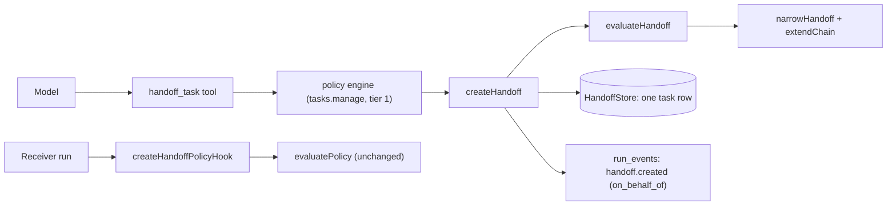

# Agent handoffs: agent-to-agent rules
Tickets: AGO-81 (created). Related: AGO-148 (agent identity), AGO-34 (policy engine), AGO-160 (claims), AGO-188 (cross-department requests, planned), AGO-117 (Manager splits goals, planned)

## What it does
Agents never chat. One agent gives work to another only by creating a **task** for it (a handoff). The receiving agent gets the **smaller** permission set, and the task keeps the identity of the **human who started the work**, so every run event in the chain says who it acts for. A human is still in the loop: a handoff carries no approval, and Tier 3 and 4 actions still need a person.

## Screens
None yet. A handoff is a worker feature; a chain view is a follow-up.

## Data model
Handoff state is a task row plus a stored chain (`HandoffRecord`): task id, sender, receiver, `requesterMemberId`, `path`, `depth`, the narrowed permissions, and the task title and description. Persistence is behind the `HandoffStore` port. **The Postgres implementation and its migration are not in this version** (they wait for the schema slot); the in-memory store in `handoff-store.test-helpers.ts` is test-only.

## Data flow

## Rules
- **Intersection, never union.** Capabilities: only keys both agents hold, enabled on both sides. Tier: the higher of the two. Mode: `approval` if either is. Budget: the smallest of the sender's remaining budget, the receiver's and the request. Data scope: the overlap of the path-prefix lists.
- **Widening is refused, not trimmed.** Asking for a capability, budget or scope the sender does not hold is a denial (`widening_capability`, `widening_budget`, `widening_scope`).
- **The requester cannot be rewritten.** It comes from the stored chain (the root task's human creator). The request schema is strict: `requester_member_id`, `on_behalf_of`, `approval_id`, `tier`, `workspace_id` and any other extra field are rejected; a claimed requester that differs from the chain is `requester_mismatch`.
- **Chains are bounded.** Maximum depth 3 (`MAX_HANDOFF_DEPTH`); a cycle or a hand-off to yourself is refused. A run with no human requester cannot hand off (`no_requester`).
- **The policy check stays.** The receiver's run is checked by `evaluatePolicy` on every tool call; `createHandoffPolicyHook` only clamps its grants to the handoff's intersection first, so a capability the sender did not pass on is `not_granted`, even if the receiver holds it. Tier 3 and 4 still escalate.
- **Only the receiver accepts.** `acceptHandoff` refuses the sender or any other agent (`wrong_agent`) and a second accept (`already_accepted`).
- **Task text is data.** The only text that reaches the receiver is the task title and description, as untrusted data. The `handoff.created` event carries a fixed reason (`task_handoff`), never task text.
- **No free-form chat.** `handoff-no-chat.guard.test.ts` fails if a run event, a worker tool or a web route looks like agent-to-agent messaging, or if a handoff event gains a recipient or text field besides the fixed reason.

## Main functions and files
| function | file | role |
|---|---|---|
| `handoffRequestSchema`, `MAX_HANDOFF_DEPTH`, `HANDOFF_DENIAL_REASONS` | `packages/shared/src/handoff/handoff-schemas.ts` | Strict request, limits, fixed reason codes (`@ago/shared/handoff`) |
| `narrowHandoff`, `extendChain`, `intersectDataScopes` | `packages/shared/src/handoff/handoff-rules.ts` | Pure intersection and chain rules |
| `evaluateHandoff` | `apps/worker/src/policy/handoff-rule.ts` | The deterministic rule: allow with narrowed permissions, or deny with a code |
| `createHandoffPolicyHook`, `clampToHandoff` | `apps/worker/src/policy/handoff-policy-hook.ts` | Receiver runs inside the intersection |
| `createHandoff`, `acceptHandoff` | `apps/worker/src/handoff/create-handoff.ts` | Writes the task row, emits the events |
| `createHandoffTool` | `apps/worker/src/handoff/handoff-tool.ts` | The `handoff_task` agent tool (capability `tasks.manage`, tier 1) |
| `HandoffStore` | `apps/worker/src/handoff/handoff-store.ts` | Persistence port |

## Run events
`handoff.created` and `handoff.accepted` gained optional `from_agent_id`, `task_id`, `on_behalf_of` and `depth` (set by the worker from the stored chain). Old events without them still parse.

## Known limits
- No Postgres store or migration yet: `tasks` needs `parent_task_id`, `handoff_from_agent_id`, `requester_member_id`, `handoff_depth` and a narrowed-grants snapshot, written only server-side. Until then handoffs exist only in the in-memory test store.
- `handoff_task` is not registered in the production tool registry yet, and the run loop does not yet call `createHandoffPolicyHook` or `acceptHandoff`.
- A dedicated `tasks.handoff` capability was not added (it needs a catalog seed); the tool reuses `tasks.manage`.
- Data scope is a list of path prefixes; richer scopes belong to AGO-188.

## How to extend it
- New narrowing dimension: add it to `narrowHandoff` (take the stricter side), add a denial code, and add a widening test.
- New denial reason: add it to `HANDOFF_DENIAL_REASONS`, return it from the rule, add a test.
- Any new agent-to-agent path must be a task. Do not add a message or chat tool, event or route; the guard test will fail.
- Tests: `pnpm --filter @ago/shared exec vitest run src/handoff` and `pnpm --filter @ago/worker exec vitest run src/handoff`.
