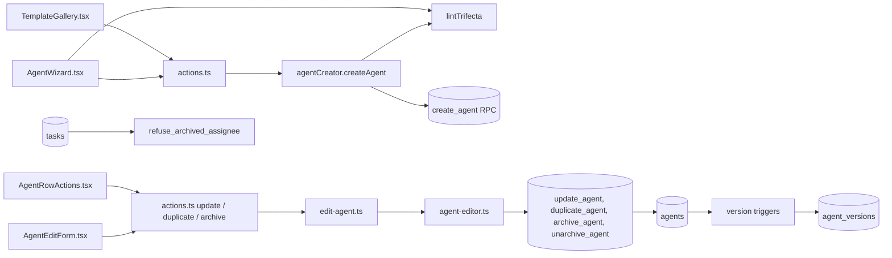

# Agents
Tickets: AGO-141 (wizard) · AGO-136 (role templates) · AGO-138 (trifecta lint) · AGO-89 (edit, duplicate, archive)

## What it does
An owner creates an agent in a short wizard or in one click from a role template. The agent is created with its skills and capability grants and always starts in Strict mode. A capability set that combines untrusted content, private data and outbound communication is refused. After that, an owner can change the agent's settings, duplicate it or archive it. Every change is kept as a numbered version.

## Screens
- **Agent wizard** (`AgentWizard.tsx`): steps for the basics, skills, capabilities, budget and a review. The Capabilities step shows the trifecta explanation live and keeps Next blocked while it applies.
- **Template gallery** (`TemplateGallery.tsx`): a template pre-fills the wizard or creates the agent directly; everything stays editable in the wizard.
- **Agent list** (`/app/agents`): each name links to the agent page. Owners see Edit, Duplicate and Archive on every active row. An "Archived" section lists archived agents with View and Unarchive. Duplicate asks for a name (it proposes "<name> copy") and says the copy starts in Strict mode.
- **Agent page** (`/app/agents/[agentId]`, `AgentEditForm.tsx`, `AgentVersionList.tsx`): owners edit name, role, model, thinking effort, prompt and daily budget and press Save. The page then says which version the agent is at. Below the form, History lists every version: kind (created, edited, archived, unarchived), changed fields, author ("You" or "A workspace <role>") and time. An archived agent shows a banner with an Unarchive button and the form is locked. Members and viewers see no controls.

## Data model
`agents`, their skills and `agent_capabilities` (one row per granted capability with its mode) in a workspace, created together by the `create_agent` function. The lint adds no table or column.

AGO-89 adds to `agents`: `thinking_effort` (`low`, `medium`, `high`; default `medium`; stored, the worker does not use it yet) and `version` (starts at 1, moves up by one when name, role, model, thinking effort, prompt, daily budget or `archived_at` changes). New table `agent_versions` holds one row per version (`change_kind`, `changed_fields`, the six settings, `changed_by`, `created_at`). It is append-only and filled by triggers on `agents`; nobody can update or delete rows. Worker writes to `status` or `run_limits` add no version.

## Data flow

## Main functions and files
| function / component | file | role |
|---|---|---|
| `AgentWizard` | `apps/web/src/features/agents/AgentWizard.tsx` | the wizard; calls `lintTrifecta` live |
| `createAgentAction`, `createAgentFromTemplateAction` | `apps/web/src/features/agents/actions.ts` | server actions; human-only |
| `agentCreator.createAgent` | `apps/web/src/features/agents/agent-library.ts` | resolves grants, runs the lint, calls the RPC |
| `lintTrifecta` | `packages/shared/src/agents/trifecta-lint.ts` | pure check of a set of capability keys |
| `AGENT_TEMPLATES` | `packages/shared/src/agents/agent-templates.ts` | the eight role templates |
| `updateAgentAction`, `duplicateAgentAction`, `archiveAgentAction`, `unarchiveAgentAction` | `apps/web/src/features/agents/actions.ts` | owner server actions; human-only |
| `updateAgentWith` and the other `...With` functions, `AgentEditor` | `apps/web/src/features/agents/edit-agent.ts` | logic and safe error messages behind an interface |
| `agentEditor` | `apps/web/src/features/agents/agent-editor.ts` | server-only; calls the four RPCs |
| `getAgentDetail`, `listArchivedAgents` | `apps/web/src/features/agents/agent-library.ts` | read the agent page and the Archived section |
| `updateAgentSchema`, `agentRefSchema`, `duplicateAgentSchema` | `packages/shared/src/agents/agent-edit-schemas.ts` | strict input; no mode, status or archive field |
| `AgentEditForm`, `AgentRowActions`, `AgentVersionList` | `apps/web/src/features/agents/` | the edit form, row buttons and history |
| `update_agent`, `duplicate_agent`, `archive_agent`, `unarchive_agent` | `supabase/migrations/20261113050001_ago_89_edit_duplicate_archive_agents.sql` | owner-checked database functions |
| `bump_agent_version`, `append_agent_version`, `refuse_archived_assignee` | same migration | version triggers and the task guard |

## Rules and edge cases
### The trifecta lint (AGO-138)

An agent that can read **untrusted content**, see **private data** and **send data out of the workspace** can be tricked by a hidden instruction on a web page into leaking what it can see. Any two of the three are allowed. All three together are blocked when an agent is created.

| Leg | Capabilities |
|---|---|
| Untrusted content | `web.search`, `web.browse` |
| Private data | `vault.read_private`, `vault.read` |
| Outbound communication | `message.send_outbound`, `integration.write` |

- **Where it runs:** the pure function `lintTrifecta` in `packages/shared/src/agents/trifecta-lint.ts` (zod-free, importable as `@ago/shared/trifecta-lint`). The wizard calls it live on the Capabilities step: the explanation appears as soon as the third leg is ticked and Next stays blocked. The server calls it in `agentCreator.createAgent`, the path the wizard and "Create from template" both use, so a hand-made request to those actions is refused too, before the database is called. It is enforced there only.
- **What the owner sees:** an error on the Capabilities field naming the three legs, the capabilities behind each, and what to do (remove at least one).
- **Mode does not matter:** a capability granted as "needs approval" still counts, because an approval can be clicked through.
- **No override yet:** the ticket asks for a security-admin approval. No such role or approval flow exists, so the owner decided (2026-11-13) on a hard block and a follow-up for the approval path.
- **Adding a capability:** map it in `trifecta-lint.ts` or list it as neutral in `trifecta-lint.test.ts`; the test fails until you do. A key the lint does not know has no leg.
- **Role templates:** all eight pass. The Researcher has web search and no private notes; the Analyst has private notes and no web.
- **Not covered:** this is an application check at `agentCreator.createAgent` only. It does not stop a call to the `create_agent` RPC or a direct insert into `agent_capabilities` made outside the app. The follow-up DB backstop must cover both the RPC and direct inserts. The security-admin approval path is also a follow-up (owner-approved hard block, no override). AGO-89 editing does not touch capabilities; the follow-up that edits them must call `lintTrifecta` on every capability change.

### Edit, duplicate, archive (AGO-89)

- **Owners only, people only.** The four actions reject agent credentials. The database checks the owner role again. Update rights on `agents` cover only the six settings and `archived_at`; `mode`, `status`, `version` and `run_limits` can never be set by a client.
- **Versions.** The form sends the version it loaded. If the agent moved on, the save is refused ("Someone else changed this agent..."), not merged. Example: two tabs open at version 2; the first saves (now 3); the second save fails and its tab must reload.
- **Duplicate.** Copies settings, skills and capabilities. Mode is never copied: the copy is Strict. Capability tiers are re-read from the catalog; a capability disabled now is skipped; tier 3 and above are forced to "needs approval". The copy gets its own version 1. An archived agent cannot be duplicated.
- **Archive.** Reversible. An archived agent cannot be edited (not even by a direct table update), duplicated or newly assigned a task (insert, or change of `agent_id` on a task, is refused with error 55000). Tasks assigned before the archive keep their agent.
- **Prompt text** is stored in every version and shown as plain text; it is never run as markup.
- **Not covered:** the worker does not yet refuse to claim work for an agent archived after assignment, and does not use `thinking_effort`. Names are not unique, so a duplicate can share a name.

## How to extend it
- New capability: map it to a leg in `trifecta-lint.ts` or list it as neutral in `trifecta-lint.test.ts`.
- New create path or capability edit: call `lintTrifecta` there too; nothing else enforces it. Duplicate copies grants from an agent that already passed.
- New editable setting: add the column to the migration's update grant and to `bump_agent_version`, `append_agent_version` and `update_agent`, then `updateAgentSchema`, `AGENT_EDITABLE_FIELDS`, `AgentEditForm` and the `FIELD_LABELS` in `AgentVersionList`.
- New wizard step or field: see `AgentWizard.tsx` and the field list in `agent-limits.ts`.
