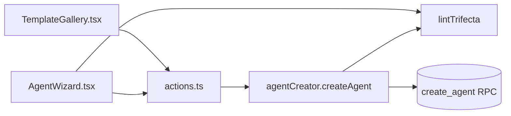

# Agents
Tickets: AGO-141 (wizard) · AGO-136 (role templates) · AGO-138 (trifecta lint)

## What it does
An owner creates an agent in a short wizard or in one click from a role template. The agent is created with its skills and capability grants and always starts in Strict mode. A capability set that combines untrusted content, private data and outbound communication is refused.

## Screens
- **Agent wizard** (`AgentWizard.tsx`): steps for the basics, skills, capabilities, budget and a review. The Capabilities step shows the trifecta explanation live and keeps Next blocked while it applies.
- **Template gallery** (`TemplateGallery.tsx`): a template pre-fills the wizard or creates the agent directly; everything stays editable in the wizard.

## Data model
`agents`, their skills and `agent_capabilities` (one row per granted capability with its mode) in a workspace, created together by the `create_agent` function. The lint adds no table or column.

## Data flow

## Main functions and files
| function / component | file | role |
|---|---|---|
| `AgentWizard` | `apps/web/src/features/agents/AgentWizard.tsx` | the wizard; calls `lintTrifecta` live |
| `createAgentAction`, `createAgentFromTemplateAction` | `apps/web/src/features/agents/actions.ts` | server actions; human-only |
| `agentCreator.createAgent` | `apps/web/src/features/agents/agent-library.ts` | resolves grants, runs the lint, calls the RPC |
| `lintTrifecta` | `packages/shared/src/agents/trifecta-lint.ts` | pure check of a set of capability keys |
| `AGENT_TEMPLATES` | `packages/shared/src/agents/agent-templates.ts` | the eight role templates |

## Rules and edge cases
### The trifecta lint (AGO-138)

An agent that can read **untrusted content**, see **private data** and **send data out of the workspace** can be tricked by a hidden instruction on a web page into leaking what it can see. Any two of the three are allowed. All three together are blocked when an agent is created.

| Leg | Capabilities |
|---|---|
| Untrusted content | `web.search`, `web.browse` |
| Private data | `vault.read_private`, `vault.read` |
| Outbound communication | `message.send_outbound`, `integration.write` |

- **Where it runs:** the pure function `lintTrifecta` in `packages/shared/src/agents/trifecta-lint.ts` (zod-free, importable as `@ago/shared/trifecta-lint`). The wizard calls it live on the Capabilities step: the explanation appears as soon as the third leg is ticked and Next stays blocked. The server calls it in `agentCreator.createAgent`, the path the wizard and "Create from template" both use, so a hand-made request to those actions is refused too, before the database is called. It is enforced there only.
- **What the owner sees:** an error on the Capabilities field naming the three legs, the capabilities behind each, and what to do (remove at least one).
- **Mode does not matter:** a capability granted as "needs approval" still counts, because an approval can be clicked through.
- **No override yet:** the ticket asks for a security-admin approval. No such role or approval flow exists, so the owner decided (2026-11-13) on a hard block and a follow-up for the approval path.
- **Adding a capability:** map it in `trifecta-lint.ts` or list it as neutral in `trifecta-lint.test.ts`; the test fails until you do. A key the lint does not know has no leg.
- **Role templates:** all eight pass. The Researcher has web search and no private notes; the Analyst has private notes and no web.
- **Not covered:** this is an application check at `agentCreator.createAgent` only. It does not stop a call to the `create_agent` RPC or a direct insert into `agent_capabilities` made outside the app. The follow-up DB backstop must cover both the RPC and direct inserts. The security-admin approval path is also a follow-up (owner-approved hard block, no override). Agent editing (AGO-89) is a follow-up too and should call `lintTrifecta` on every capability change.

## How to extend it
- New capability: map it to a leg in `trifecta-lint.ts` or list it as neutral in `trifecta-lint.test.ts`.
- New create path (for example editing in AGO-89): call `lintTrifecta` there too; nothing else enforces it.
- New wizard step or field: see `AgentWizard.tsx` and the field list in `agent-limits.ts`.
