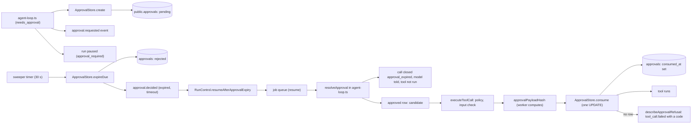

# Approval requests
Tickets: AGO-21 (created) · AGO-47 (payload-hash binding, single use, expiry limit) · AGO-51 (timeout means deny, guarded by a static check) · AGO-58 (human-only decide route, agent tokens refused with an event, Reviewer verdict is advisory)

## What it does
When the policy engine says a tool call `needs_approval` (tier 3 and 4, or any call a policy escalates), the worker
records a **pending approval**, pauses the run, and waits for a human. If nobody answers in time the approval becomes
`rejected` and the agent is told the call was not run. A human is always in the loop: nothing here lets an agent or the
loop approve anything, and the tool runs in no path that is not an honoured approval. An approval is honoured only
for the exact call it was given for, once, and before it expires (AGO-47). The only thing that writes `approved` or
`denied` is a person, through the human-only decide route (AGO-58, below).

## Screens
None yet. The inbox UI is AGO-37; it will call `POST /api/approvals/[id]/decision`. Until it ships, a member can decide
through that route directly, and every request nobody answers still ends in a timeout denial.

## Data model
One table, `public.approvals` (created in AGO-74, RLS in AGO-107). This feature adds no migration.

| Column | Use here |
|---|---|
| `id` | derived from run id, step and call id (see "Ids and retries") |
| `workspace_id`, `run_id`, `agent_id` | who and where; every statement is scoped by `workspace_id` |
| `action` | the tool name only, never its input |
| `payload_hash` | hash of the call's input; the payload itself is never stored |
| `status` | `pending`, then `rejected` (worker, on expiry), or `approved` / `denied` (a human, through RLS) |
| `expires_at` | when a pending request times out, and the last moment an approved one can be used (`now >= expires_at` is expired) |
| `consumed_at` | set once by the worker when an approved row is used; a consumed row never grants again |

`APPROVAL_STATUS` and `APPROVAL_ACTION_MAX_LENGTH` live in `packages/shared`.

## Data flow

## Main functions and files
| function / component | file | role |
|---|---|---|
| `createAgentLoop` (escalation branch) | `apps/worker/src/agent/agent-loop.ts` | creates the pending row before the event and the pause |
| `resolveApproval` | `apps/worker/src/agent/agent-loop.ts` | on resume: wait again, expire a late row itself, or close the call unrun |
| `executeToolCall` (`grantedApprovalId`) | `apps/worker/src/agent/agent-loop.ts` | for an approved call: policy, input check, hash, consume, then the tool |
| `uniqueStepCallIds` | `apps/worker/src/agent/agent-loop.ts` | one distinct call id per call in a step |
| `approvalPayloadHash`, `canonicalJson` | `apps/worker/src/approvals/payload-hash.ts` | the one hash used on both the request and grant sides |
| `describeApprovalRefusal` | `apps/worker/src/approvals/approval-refusal.ts` | picks the denial code from the row |
| `approvalIdFor` | `apps/worker/src/approvals/approval-id.ts` | deterministic UUID for one call |
| `createPgApprovalStore` (`create`, `get`, `expire`, `expireDue`, `consume`) | `apps/worker/src/approvals/approval-store.ts` | the only SQL; idempotent create, conditional expire |
| `expireDueApprovals`, `createApprovalExpirySweeper` | `apps/worker/src/approvals/expire-approvals.ts` | one sweep pass, and the interval timer |
| `createRunControl().resumeAfterApprovalExpiry` | `apps/worker/src/queue/run-control.ts` | the narrow system wake-up |
| `createJobQueue` | `apps/worker/src/queue/job-queue.ts` | builds the sweeper; starts and stops it with the queue |
| `createProductionAgentExecutor` | `apps/worker/src/agent/wire.ts` | gives the loop its pg approval store |
| `run.resumed` schema | `packages/shared/src/events/run-events.ts` | `resumed_by` is `human` or `timeout`, never `agent` |

## Rules and edge cases
**Request.** The policy check runs before the tool. On `needs_approval` the loop writes the row, then emits
`approval.requested` with the same id, then saves the call as `awaiting_approval` and pauses the run
(`pauseReason: approval_required`). If the row cannot be written the run errors and is retried; the tool never runs.
Tier 0 and 1 calls, and calls the policy denies, never reach this branch: no row exists for them.

**Ids and retries.** `approval_id` comes from `(run id, step, call id)`, so a crashed attempt that raises the same call
again finds the same row instead of making a second one. A row bound to a different run or payload hash is a conflict,
never reused.

**Expiry has two paths and one result.**
- Sweeper: one conditional update moves due `pending` rows to `rejected` (batch of 100, `skip locked`). Only the caller
  that moved a row writes `approval.decided` (`outcome: expired`, `decided_by: timeout`) and wakes the run, so two
  sweeps cannot both act. The sweeper starts only on a worker that runs agents.
- Resume-time check: a resumed call whose approval is `pending` but past `expires_at` is expired and denied right
  there, so timeout means deny even if the sweeper is late or down.

**The wake-up is narrow on purpose.** `resumeAfterApprovalExpiry` has no actor and no route. It writes `run.resumed`
with `resumed_by: timeout`, and the only thing the resumed run can do is deny. It wakes a run only when the
checkpoint's open step has a call awaiting **exactly** the expired approval (the id is recomputed from run, step and
call id); a run waiting on a different approval, another step, or with no checkpoint answers `not_waiting`. It never
overrides a human: if a human asked for a pause, the answer is `human_paused`, the run stays paused, the pause request
is kept, and the expired call is closed `approval_expired` when the human resumes. `resumeRun` still requires a human,
and a timeout resume does not clear a human's pause request.

**What runs (AGO-47).** A resumed call runs only when its approval is `approved`, unused, not past `expires_at`, and
bound to the exact call. In order: (1) `resolveApproval` screens the row (no state change); (2) `executeToolCall` asks
the policy again and validates the input: a policy deny, an unoffered tool or invalid input closes the call and leaves
the approval untouched; (3) the worker computes `approvalPayloadHash(tool name, input)` itself (SHA-256 of the canonical
JSON, so key order does not matter and any value change does), never taking a hash from the model, checkpoint or row;
(4) `ApprovalStore.consume` does one conditional update (workspace, run, `approved`, `consumed_at is null`,
`expires_at > now`, same hash) and returns the row to exactly one caller; (5) only then does the tool run. A consumed
approval is spent even if the tool fails. This holds even when the policy now says plain `allow`.

**What does not run.** Every other case is a denial with its own `error_code` on `tool_call.failed`:
`approval_payload_mismatch` (approved, different call), `approval_already_used`, `approval_expired` (approved, pending
or rejected past its limit; `now == expires_at` is expired), `approval_denied`, otherwise `approval_not_granted`
(missing row, other workspace or run, no store, pending-with-other-hash).

**Same call id twice in a step.** The loop gives a repeated or invalid call id its index-based id
(`call_<step>_<index>`, made unique), so each call has its own approval row and an approval for index 0 never grants
index 1.

**Accepted gaps (owner Decision 4, recorded in `docs/tickets/AGO-21.md`).**
- ~~The timeout wake checked the pause flag, then moved the run a few database calls later.~~ **Fixed in AGO-58.** The
  wake is now one conditional update (`RunStore.wakeRunAfterExpiry`): the run moves `paused` → `queued` only if the
  human pause flag is not set, in the same statement. Two concurrent wakes make exactly one transition, and a human
  re-pause window is narrowed to a single statement (it was several awaited calls; under READ COMMITTED it is not
  zero). Tests: `run-control.test.ts` (fake store) and `run-store.wake.integration.test.ts` (the SQL, live database).
- `approval.decided` is not retried. It can be missing if the sweep's update succeeds and the event write fails
  (logged and sent to the error tracker), and likewise in the resume-time check. The call is denied either way; only
  the audit event is lost.
- A run still `running` when its approval expires is denied on its next resume instead of being woken.

**Follow-ups.** `resumeRun` with an undefined actor throws a `TypeError` instead of
`HumanActorRequiredError` (pre-existing `assertHuman`); the call is still refused.

## Timeout means deny (AGO-51)
A timeout can only deny. The system writes `rejected` (never `approved`; `denied` stays reserved for a human), the agent
gets `approval_expired` with the text "expired before a human answered. It was not run.", an `approval.decided`
(`expired`, `timeout`) event is appended, and the run finishes instead of waiting. This is covered end to end on the
sweeper path and the resume-time path in `agent-loop.approvals.test.ts` (including exactly at, just after and long after
the limit, and that a late human `approved` row is refused and left as the human wrote it).

**The static check** (`apps/worker/src/approvals/no-auto-approve.test.ts`, part of `pnpm test`) fails the build when any
source could approve without a human. It scans non-test `.ts`/`.tsx` under `apps/**` and `packages/**` and every
`supabase/migrations/*.sql` for:

| Rule | Catches |
|---|---|
| R1 status write | `status: approved`, `status` shorthand, `x.status = approved`, a setter call such as `setStatus(id, "approved")`; also through a constant, a pure alias (`const s = APPROVAL_STATUS`, an import alias), a concatenation or a ternary |
| R2 timeout allows | an expiry/timeout/deadline/ttl/sweep handler, or an `if`/`?:` on an expiry condition, that resolves to allow, approved or proceed or runs the call; an `approval.decided` event that is `approved` and decided by the timeout |
| R3 SQL approves | `UPDATE ... SET status = 'approved'`, `new.status := 'approved'`, `new.status = 'approved'` at the start of a statement (a plain `=` in plpgsql is an assignment), an `INSERT` whose values contain a literal `'approved'`, a `$n` bound to approved in an `UPDATE`, a SQL `||` join, or a plpgsql variable bound to approved (`v := 'approved'`, `declare v text := 'approved'`, `v text default 'approved'`, a `::text` cast, a chain `b := a`), in `.sql` files and in strings in TypeScript (also built with `+`) |

Comparisons are not writes and stay clean: `where status = 'approved'`, `if new.status = 'approved'`, `case when status = 'approved'`, a trigger `when (new.status = 'approved')`, and `set status = case when status = 'approved' ...`.

The test proves itself: planted violations in `__fixtures__/auto-approve/` (a direct update, a computed status, SQL strings,
a ternary on expiry, a timeout-decided approved event, a DB trigger, a cron update, a CASE expression, a plain `=` assignment
in plpgsql, a setter called with `approved`, aliases of approved, a `+` and a `||` concatenation) must each be reported,
the comparison forms in `clean-comparisons.sql.fixture` and look-alikes that only read `approved` must not, a sanity check asserts the real scan saw the files, and two
violations planted into the real `approval-store.ts` and `expire-approvals.ts` text must be caught. The fixtures folder
and the Playwright `e2e/` folder (which plays the human decider against a local database) are excluded explicitly.

**The one exception.** The human decide route (AGO-58) writes `approved`. Its file
(`apps/web/src/features/approvals/decide-approval.ts`) is the single entry in `HUMAN_DECISION_FILES` in the check,
which keeps the exception visible in review. The check is a tripwire
(it follows constants, pure aliases, concatenations and ternaries within one file, not a status built across files); the
runtime enforcement remains the conditional `expire` and `consume` SQL, the RLS policy and the loop's refusal codes.

**Known limitations.**
The static check is a tripwire, not a proof. It follows values inside one file: constants, pure aliases (`const s = APPROVAL_STATUS`, an import alias), `+` and template concatenation, ternaries, SQL `||` joins and plpgsql variables. It does not follow these shapes, so review is the backstop for them:
- computed keys: `{ ["status"]: "approved" }`, `{ [k]: "approved" }`, `row["sta" + "tus"] = ...`
- object and array indirection: `const S = { ok: "approved" }; S.ok`, `["approved"][0]`
- cross-file indirection: a constant, helper or return value defined in another module
- runtime-built values: `.join("")`, `.toLowerCase()`, row data, a function's return value, a parameter
- plpgsql dynamic SQL (`execute format(...)`), and SQL assembled in another file
- setter calls whose name is not a write verb (`set`, `update`, `mark`, `save`, `write`, `change`, `transition`, `record`) followed by `Status`, `Decision` or `Outcome`, or whose status argument is not a literal or a bound alias (`store.write(id, "approved")`)
- name shadowing: variables and aliases are bound per file, not per function or block, and the last declaration wins, so a name reused in another function can bind to the wrong value (a false positive or a miss)
- flow-insensitive reassignment: one value per name per file. A variable bound to approved and later reassigned to a safe value still counts (a false positive), and a variable reassigned to approved through an expression the scanner cannot evaluate (`v := f()`) is missed
- INSERT with `$n` bound to approved: only a literal `'approved'` in an INSERT is caught
- plpgsql declaration forms the variable binder does not read (a plain `v := 'approved'` assignment is still caught): `v constant text := 'approved'`, `v text not null := 'approved'`, `v t.col%type := 'approved'`, and a schema-qualified type `v public.status_t := 'approved'`. Only `name [type] := value` and `name [type] default value`, with a one-word type and optional `(n)`, bind
- files outside the scanned roots. The scan covers `apps/`, `packages/` and `supabase/migrations/` only, and only `.ts`, `.tsx` and `.sql`. These are never read: `supabase/seed.sql`, `supabase/tests/*.sql`, `supabase/rollbacks/*.sql`, and `.js`, `.mjs` and `.cjs` files under `apps/` and `packages/`
- folders and files skipped on purpose: any folder named `e2e` (Playwright code that plays the human decider against a local database, `apps/web/e2e`), `__fixtures__`, `node_modules`, `dist`, `.next`, `.turbo`, `coverage`, plus `*.test.ts(x)`, `*.spec.ts(x)` and `*.d.ts` files. Code placed in one of these is not checked

## Human-only decisions (AGO-58)
**The route.** `POST /api/approvals/[id]/decision` with `{ workspace_id, decision: "approved" | "denied" }` (strict: a
`payload_hash`, `status` or any other key is a 400). Order: (1) `rejectAgentCredential` → 403 plus an event; (2) Zod
input → 400; (3) signed-in → 401, workspace member → 403; (4) update scoped by workspace and `pending`, not consumed,
not expired → 200 `{ id, status }` or 404 when nothing could be decided. It runs on the caller's own session (RLS policy
`approvals_update_member`), never a service role, and writes only `status`, `decided_by`, `decided_at`: the payload
hash stays what the runtime stored, so the decision still unlocks only the exact call it was raised for (AGO-47).

**An agent token is refused with 403 and an event.** `proxy.ts` refuses any `ago_agt_` credential first. On an approval
path (`/api/approvals…`) it also calls `recordAgentRouteRejection`, and the route repeats the guard and the record as a
second layer. The recorder verifies the token's signature in the web layer first (`@ago/shared/credential-token`, the
same code the worker uses); only a genuinely signed credential names a real run, so only then is one event
`error.raised` with the fixed code `approval_route_rejected` and the message `<METHOD> <route>` appended (the approved v1
event list is not amended; the run row names the agent), through the narrow database function
`record_agent_approval_rejection` (`run_events` is runtime-only; the function is executable by `service_role` only, and
the server-only recorder uses `SUPABASE_SERVICE_ROLE_KEY` for this one call, nowhere else in the web app; the decide
route itself still uses the member's own session). The function checks the credential id belongs to the named
workspace, agent and run, accepts only approval routes and five methods, and stays quiet past 20 events per run per
minute (best-effort: parallel requests can slightly exceed the cap; a hard cap is a follow-up). The event never
holds the token, a header, the body or the query. A forged or malformed token still gets the same 403; it has no
verifiable run, so it is logged (reason code and route only) and no event is written.

**A Reviewer's APPROVE does not satisfy a Tier 3 gate.** The gate reads one thing: an `approved` approval row bound to
the call's payload hash. A Reviewer verdict (AGO-140) is advice shown to the human; nothing turns it into a row
(`REVIEWER_VERDICT_IS_ADVISORY`, `satisfiesApprovalGate` in `packages/shared`). Tested in
`agent-loop.approvals.reviewer.test.ts`: after a Reviewer APPROVE the approval stays pending and the call does not run;
a human approval bound to a different payload does not run it either; a human approval of the exact call runs it once.

**Inventory of approval-deciding entry points** (each proven to refuse an agent token, or to be unable to decide):

| Entry point | Can it decide? | Agent token | Proof |
|---|---|---|---|
| `POST /api/approvals/[id]/decision` | yes, human only | 403 + event (proxy and route) | `route.test.ts`, `record-agent-rejection.test.ts` |
| Any other route under `/api/approvals` | none exist | 403 at the proxy | `approval-deciders.inventory.test.ts` |
| Server actions | none touch approvals | `requireHumanRequest` required if one is added | inventory test |
| Direct table write from web | only `decide-approval.ts` | not reachable without the route | inventory test, `no-auto-approve.test.ts` |
| Database policy `approvals_update_member` | a member, not an agent | agent tokens carry no member session | AGO-107 RLS tests |
| Worker (`resolveApproval`, `consume`) | reads `approved`, never writes it | n/a | `no-auto-approve.test.ts` |
| Sweeper (`expire`) | writes `rejected` only | n/a | AGO-51 tests |

**Follow-ups (not in this ticket).** The AGO-51 scanner still has declare-default gaps and fixed scan roots; closing
them means editing `scripts/`, which keeps this PR on the agent-merge path, so they are recorded in
`docs/tickets/AGO-58.md`.

## How to extend it
- **Possible false positives.** The check is name-based, so a UI helper can match it. Examples: a React state setter such as `setStatus("approved")` (a filter or a local view state, not an approval), or a count object such as `stats.status.approved` assigned to a `status` property. Fix them in this order: rename the identifier so it no longer matches (for example `setStatusFilter`, or `approvedCount` instead of `status.approved`); or move the code out of the scanned roots. Do not add a file to `HUMAN_DECISION_FILES` to silence a false positive; that list is only for the human decide route (AGO-58), and review must see it.
- Add another way to decide: do not. The decide route (AGO-58) is the one human entry point. A second one must be added
  to the inventory test (`approval-deciders.inventory.test.ts`) and `HUMAN_DECISION_FILES` on purpose, call
  `rejectAgentCredential` first, and write only `status`, `decided_by` and `decided_at`.
- A crash between `consume` and the `started` checkpoint leaves a spent approval; the call is then denied on resume
  (`approval_already_used`) and the human must approve again. Safe, by design.
- The checkpoint stores a scrubbed copy of the input (AGO-30); a call the scrubber changes hashes differently and is
  refused `approval_payload_mismatch` (fail closed).
- Change the timeout: the TTL is `approvalTtlMs` in the loop deps; the sweep interval is `intervalMs`.
- Add a status: add it to `APPROVAL_STATUS` in `packages/shared`, then decide in `resolveApproval` what a resumed call
  does with it. Unknown statuses must stay a denial.
- Rollback is a plain revert; rows left behind are harmless.
