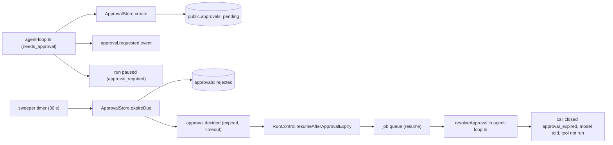

# Approval requests
Tickets: AGO-21 (created)

## What it does
When the policy engine says a tool call `needs_approval` (tier 3 and 4, or any call a policy escalates), the worker
records a **pending approval**, pauses the run, and waits for a human. If nobody answers in time the approval becomes
`rejected` and the agent is told the call was not run. A human is always in the loop: nothing here lets an agent or the
loop approve anything, and the tool runs in no path that is not an honoured approval. Today none is honoured.

## Screens
None yet. The decide routes (approve or deny) and the inbox UI are AGO-58 and AGO-37. Until then nobody can answer a
request, so every request ends in a timeout denial.

## Data model
One table, `public.approvals` (created in AGO-74, RLS in AGO-107). This feature adds no migration.

| Column | Use here |
|---|---|
| `id` | derived from run id, step and call id (see "Ids and retries") |
| `workspace_id`, `run_id`, `agent_id` | who and where; every statement is scoped by `workspace_id` |
| `action` | the tool name only, never its input |
| `payload_hash` | hash of the call's input; the payload itself is never stored |
| `status` | `pending`, then `rejected` (worker, on expiry), or `approved` / `denied` (a human, through RLS) |
| `expires_at` | when a pending request times out |

`APPROVAL_STATUS` and `APPROVAL_ACTION_MAX_LENGTH` live in `packages/shared`.

## Data flow

## Main functions and files
| function / component | file | role |
|---|---|---|
| `createAgentLoop` (escalation branch) | `apps/worker/src/agent/agent-loop.ts` | creates the pending row before the event and the pause |
| `resolveApproval` | `apps/worker/src/agent/agent-loop.ts` | on resume: wait again, expire a late row itself, or close the call unrun |
| `approvalIdFor` | `apps/worker/src/approvals/approval-id.ts` | deterministic UUID for one call |
| `createPgApprovalStore` (`create`, `get`, `expire`, `expireDue`) | `apps/worker/src/approvals/approval-store.ts` | the only SQL; idempotent create, conditional expire |
| `expireDueApprovals`, `createApprovalExpirySweeper` | `apps/worker/src/approvals/expire-approvals.ts` | one sweep pass, and the interval timer |
| `createRunControl().resumeAfterApprovalExpiry` | `apps/worker/src/queue/run-control.ts` | the narrow system wake-up |
| `createJobQueue` | `apps/worker/src/queue/job-queue.ts` | builds the sweeper; starts and stops it with the queue |
| `createProductionAgentExecutor` | `apps/worker/src/agent/wire.ts` | gives the loop its pg approval store |
| `run.resumed` schema | `packages/shared/src/events/run-events.ts` | `resumed_by` is `human` or `timeout`, never `agent` |

## Rules and edge cases
**Request.** The policy check runs before the tool. On `needs_approval` the loop writes the row, then emits
`approval.requested` with the same id, then saves the call as `awaiting_approval` and pauses the run
(`pauseReason: approval_required`). If the row cannot be written the run errors and is retried; the tool never runs.
Tier 0 and 1 calls, and calls the policy denies, never reach this branch: no row exists for them.

**Ids and retries.** `approval_id` comes from `(run id, step, call id)`, so a crashed attempt that raises the same call
again finds the same row instead of making a second one. A row bound to a different run or payload hash is a conflict,
never reused.

**Expiry has two paths and one result.**
- Sweeper: one conditional update moves due `pending` rows to `rejected` (batch of 100, `skip locked`). Only the caller
  that moved a row writes `approval.decided` (`outcome: expired`, `decided_by: timeout`) and wakes the run, so two
  sweeps cannot both act. The sweeper starts only on a worker that runs agents.
- Resume-time check: a resumed call whose approval is `pending` but past `expires_at` is expired and denied right
  there, so timeout means deny even if the sweeper is late or down.

**The wake-up is narrow on purpose.** `resumeAfterApprovalExpiry` has no actor and no route. It writes `run.resumed`
with `resumed_by: timeout`, and the only thing the resumed run can do is deny. It wakes a run only when the
checkpoint's open step has a call awaiting **exactly** the expired approval (the id is recomputed from run, step and
call id); a run waiting on a different approval, another step, or with no checkpoint answers `not_waiting`. It never
overrides a human: if a human asked for a pause, the answer is `human_paused`, the run stays paused, the pause request
is kept, and the expired call is closed `approval_expired` when the human resumes. `resumeRun` still requires a human,
and a timeout resume does not clear a human's pause request.

**What runs (AGO-47).** A resumed call runs only when its approval is `approved`, unused, not past `expires_at`, and
bound to the exact call. In order: (1) `resolveApproval` screens the row (no state change); (2) `executeToolCall` asks
the policy again and validates the input: a policy deny, an unoffered tool or invalid input closes the call and leaves
the approval untouched; (3) the worker computes `approvalPayloadHash(tool name, input)` itself (SHA-256 of the canonical
JSON, so key order does not matter and any value change does), never taking a hash from the model, checkpoint or row;
(4) `ApprovalStore.consume` does one conditional update (workspace, run, `approved`, `consumed_at is null`,
`expires_at > now`, same hash) and returns the row to exactly one caller; (5) only then does the tool run. A consumed
approval is spent even if the tool fails. This holds even when the policy now says plain `allow`.

**What does not run.** Every other case is a denial with its own `error_code` on `tool_call.failed`:
`approval_payload_mismatch` (approved, different call), `approval_already_used`, `approval_expired` (approved, pending
or rejected past its limit; `now == expires_at` is expired), `approval_denied`, otherwise `approval_not_granted`
(missing row, other workspace or run, no store, pending-with-other-hash).

**Same call id twice in a step.** The loop gives a repeated or invalid call id its index-based id
(`call_<step>_<index>`, made unique), so each call has its own approval row and an approval for index 0 never grants
index 1.

**Accepted gaps (owner Decision 4, recorded in `docs/tickets/AGO-21.md`).**
- The timeout wake checks the pause flag, then moves the run to `queued`, with a few database calls between. A stale
  wake in that window could override a human's re-pause for one step of calls the policy already allows (tier 3 and 4
  still need approval). Nothing in production calls pause or resume yet. It must be fixed in or before AGO-58.
- `approval.decided` is not retried. It can be missing if the sweep's update succeeds and the event write fails
  (logged and sent to the error tracker), and likewise in the resume-time check. The call is denied either way; only
  the audit event is lost.
- A run still `running` when its approval expires is denied on its next resume instead of being woken.

**Follow-ups.** `resumeRun` with an undefined actor throws a `TypeError` instead of
`HumanActorRequiredError` (pre-existing `assertHuman`); the call is still refused.

## How to extend it
- Add the human decision: write `approved` or `denied` from a human-only route (AGO-58). The grant path (hash binding,
  single use, expiry) already exists; the route only has to write the status.
- A crash between `consume` and the `started` checkpoint leaves a spent approval; the call is then denied on resume
  (`approval_already_used`) and the human must approve again. Safe, by design.
- The checkpoint stores a scrubbed copy of the input (AGO-30); a call the scrubber changes hashes differently and is
  refused `approval_payload_mismatch` (fail closed).
- Change the timeout: the TTL is `approvalTtlMs` in the loop deps; the sweep interval is `intervalMs`.
- Add a status: add it to `APPROVAL_STATUS` in `packages/shared`, then decide in `resolveApproval` what a resumed call
  does with it. Unknown statuses must stay a denial.
- Rollback is a plain revert; rows left behind are harmless.
