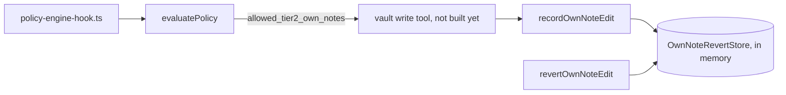

# Autonomy dial
Tickets: AGO-43 (created)

## What it does

Each agent runs in one mode, stored in `agents.mode` (default `strict`; an unknown value is read as strict). People set the mode; no agent can. The mode decides how much an agent may do without asking a human.

| Tier | Strict | Standard | Relaxed |
|---|---|---|---|
| 0-1 | runs | runs | runs |
| 2 | asks a human | runs if the grant is automatic | runs if the grant is automatic; own-notes edits (`vault.write_own`) also run when the grant is approval mode, with a revert record |
| 3-4 | asks a human | asks a human | asks a human |

Tier 3 and 4 always escalate, in every mode, whatever the grants or `allow` rules say. A deny rule or a `require_approval` rule still wins over Relaxed. The proof is `packages/shared/src/policy/autonomy-dial.test.ts` (every mode x grant mode x capability x allow rule).

## Screens

None yet. No screen or API sets the mode (see "How to extend it").

## Data model

No new tables or columns. The mode lives in the existing `agents.mode` text column. Own-note revert records are in memory behind `OwnNoteRevertStore` (workspace id, agent id, note id, previous content, hash of the new content, reverted flag).

## Data flow

## Main functions and files

| function / component | file | role |
|---|---|---|
| `evaluatePolicy` | `packages/shared/src/policy/policy-engine.ts` | The decision. Step 7b allows own-notes edits in Relaxed after deny, Tier 3/4 and require-approval checks |
| `parsePolicyAgentMode` | same | Reads a stored mode; unknown becomes `strict` |
| `POLICY_AGENT_MODES`, `OWN_NOTES_CAPABILITY` | same | The three modes and the one capability Relaxed may auto-run |
| `recordOwnNoteEdit` | `apps/worker/src/policy/own-note-revert.ts` | Snapshot before an auto-applied edit |
| `revertOwnNoteEdit` | same | Returns the old content or refuses |
| `createInMemoryOwnNoteRevertStore` | same | In-memory `OwnNoteRevertStore` |

## Rules and edge cases

- Reverting own-note edits: the vault write tool must call `recordOwnNoteEdit` before it writes; if that throws, it must not write.
- A revert is refused (`not_found`, `wrong_agent`, `already_reverted`, `note_changed`) for another agent or workspace, a second revert, or when the note changed after the edit. Refusals never contain note text.
- Look-alike capability keys do not match `vault.write_own`; other Tier 2 capabilities with an approval-mode grant still escalate in Relaxed.
- Records are lost on worker restart until the persistent store exists.

## How to extend it

- Add a mode: extend `POLICY_AGENT_MODES` and the engine, and add rows to the tier-by-mode table in `policy-engine.test.ts`. Keep the Tier 3/4 test in `autonomy-dial.test.ts` green.
- Add another auto-run capability for Relaxed: only with an owner decision; widen the step 7b condition and add a test.
- Persistent revert: implement `OwnNoteRevertStore` on Postgres (needs a migration and the schema slot) and wire it into the vault write tool (AGO-121).
- Mode setter: a person-only route plus a check constraint on `agents.mode` (needs the schema slot).
