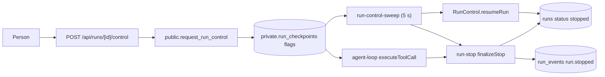
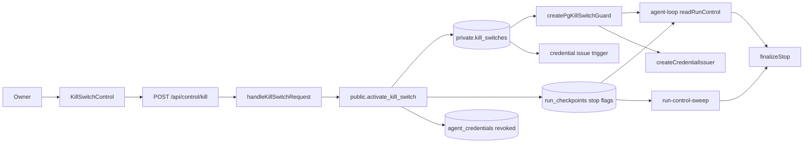

# Run control: pause, resume, stop and the kill switch
Tickets: AGO-86 (created) · AGO-84 (added the kill switch)

## What it does
A person can pause, resume or stop any agent run, and a workspace owner can pull a kill switch that contains a whole workspace or one agent. Only a person: agent credentials are refused on the control route, and the database function behind it refuses them too. The web app only records the request. The worker makes it happen.

## Screens
Owners see a "Kill switch" button on the workspace home page (`/app`); members do not. It asks for confirmation, then reports how many runs are stopping and how many credentials were revoked. There is no release button and no latched indicator after a reload yet. For single runs there is no screen yet: the route `POST /api/runs/[id]/control` (body `{ workspace_id, action: "pause" | "resume" | "stop" }`) is the only entry point. The right-click controls UI is AGO-178.

Answers: 200 `{ id, action, status: "accepted" }`; 400 bad input; 401 not signed in; 403 agent credential or not a member; 404 the run is not in a state the action applies to (or is already stopped); 500 `control_unavailable`.

## Data model
Three nullable columns on `private.run_checkpoints` (worker-only table, no grants for web roles): `pause_requested_at`, `stop_requested_at` (never cleared: stop is final), `resume_requested_at`, plus `control_requested_by` (the person, audit only). `public.runs.status` gains the free-text value `stopped`. No new table. `public.request_run_control(p_workspace_id, p_run_id, p_action)` is a `SECURITY DEFINER` function, executable by `authenticated` only. It writes no `run_events` and no `runs` row.

## Data flow

## Main functions and files
| function / component | file | role |
|---|---|---|
| `POST` | `apps/web/src/app/api/runs/[id]/control/route.ts` | Agent guard, Zod input, member check, one call to the function |
| `requestRunControl` | `apps/web/src/features/runs/request-run-control.ts` | Calls the RPC with the caller's own session |
| `runControlBodySchema`, `isRunControlRoute` | `packages/shared/src/runs/run-control.ts` | Body schema and the path matcher for the rejection event |
| `request_run_control` | `supabase/migrations/20261114150001_ago_86_run_control.sql` | Human session and member check, then sets one flag. Down script: `supabase/rollbacks/20261114150001_ago_86_run_control.down.sql` |
| `readRunControl`, `executeToolCall` | `apps/worker/src/agent/agent-loop.ts` | Reads the flags first thing in every tool call; also at step start and after each model answer |
| `readControl`, `listControlRequests`, `clearStaleControlRequests`, `finishStopTail` | `apps/worker/src/agent/checkpoint-store.ts` | Flag reads, sweep listing, stale cleanup, finishing a stop tail under a row lock |
| `finalizeStop` | `apps/worker/src/queue/run-stop.ts` | Closes approvals, moves the run to `stopped`, writes `run.stopped`, drops the flags |
| `sweepControlRequests`, `createControlSweeper` | `apps/worker/src/queue/run-control-sweep.ts` | Applies stop and resume to runs with no loop; started in `job-queue.ts` |
| `rejectPendingForRun` | `apps/worker/src/approvals/approval-store.ts` | `pending` to `rejected` for a stopped run |
| `markStopped`, `resumeRun` | `apps/worker/src/queue/run-store.ts` | Conditional status updates; `resumeRun` refuses a run with a stop request |
| human-only guard | `apps/web/src/proxy.ts` | Reuses the AGO-58 guard and rejection event for the control path |

## Rules and edge cases
- Order for one tool call: control flag, then policy, then tool (budget slots between control and policy when AGO-40 lands, with an ordering test then). A pause or stop leaves the call unrun in the checkpoint, so a resume runs it from the top. A flag that cannot be read throws and the attempt is retried: fail closed.
- A tool already running when a pause or stop arrives finishes; none starts after it.
- A stop wins over a pause and over a resume. A running run is ended by its own loop; a queued or paused run by the control sweep. Nothing leaves `stopped`: `resumeRun` and the approval-expiry wake both refuse a run with a stop request.
- Stopping closes the run's pending approvals as `rejected` with an `approval.decided` event (`denied`, by a human). The runtime never writes `approved`.
- The mover of the run writes `run.stopped` (`stopped_by: human`, `reason: stopped_by_human`) and then drops the checkpoint. If that write fails, the run stays `stopped` with the flag set, and the next sweep finishes it under a row lock. Known limit: a narrow window between `markStopped` and the unlocked write can let a second worker write `run.stopped` twice (see the ticket's follow-up). The run state and approvals are unaffected.
- The sweep first forgets requests of finished runs, so stale rows never fill its 100-row batch. A resume request naming no person is ignored; the resume flag is cleared after one attempt.
- Resume bypasses nothing: it only moves `paused` to `queued`; the loop re-reads approvals, budgets and policy.
- A `running` run whose worker died is only stopped when a retry reclaims it.

## Kill switch (AGO-84)
One owner action contains a whole workspace or one agent. Routes: `POST /api/control/kill` and `POST /api/control/kill/release`, body `{ workspace_id, scope: "workspace" | "agent", agent_id? }` (an agent scope needs `agent_id`; a workspace scope must not carry one). Answers 200 `{ scope, status: "active" | "released", runs_stopped, credentials_revoked }`; 400 bad input; 401 not signed in; 403 agent credential or not an owner; 500 `kill_switch_unavailable`. Agent credentials are refused first (the AGO-58 guard and its audit event `control_route_rejected`, reused). The UI control is `KillSwitchControl` (`apps/web/src/features/control`), mounted on `app/app/page.tsx` for owners only: two steps, a confirmation that says what will happen, then the call.

Data: `private.kill_switches` is the latch, one live row (`released_at is null`) per workspace or agent scope, with who and when. RLS on, no grants for any web role. `public.activate_kill_switch` and `public.release_kill_switch` are `SECURITY DEFINER`, executable by `authenticated` only, and refuse a caller with no user session, an agent claim, or who is not an owner of the workspace. Trigger `check_kill_switch_on_credential_issue` on `public.agent_credentials` refuses (42501) a new credential while a live latch covers it.

What activating does: (1) latches the scope; (2) flags every queued, running or paused run in scope for a stop (the AGO-86 flag), which the loop obeys before its next tool call and the control sweep applies to runs with no loop; (3) revokes every live credential in scope (`revoked_at` set, rows kept). While latched: no credential is issued (`KillSwitchActiveError` in the issuer, the trigger in the database), and a run picked up in scope is stopped before its first tool call (the loop reads the latch in `readRunControl`, next to the pause and stop flags; a failed read fails closed). Releasing the latch lets new work start; stopped runs stay stopped and revoked credentials stay revoked. A repeat activation changes nothing and reports zero.

State is preserved: nothing is deleted. Credential rows stay (revoked), run rows and run events stay, each stopped run gets one `run.stopped`, and the latch row records who and when. The audit reason of a latch-caused stop stays `stopped_by_human`; the latch row is the kill record.

| function / component | file | role |
|---|---|---|
| `activate_kill_switch`, `release_kill_switch`, `check_kill_switch_on_credential_issue` | `supabase/migrations/20261117010001_ago_84_kill_switch.sql` | Latch, flag, revoke, release, database issuance wall. Down script: `supabase/rollbacks/20261117010001_ago_84_kill_switch.down.sql` |
| `handleKillSwitchRequest` | `apps/web/src/features/control/handle-kill-switch-request.ts` | Shared body of both routes: agent refusal, Zod, status mapping |
| `activateKillSwitch`, `releaseKillSwitch` | `apps/web/src/features/control/request-kill-switch.ts` | Owner check, one RPC with the caller's session |
| `killSwitchBodySchema`, `isKillSwitchRoute` | `packages/shared/src/runs/kill-switch.ts` (client import: `@ago/shared/kill-switch`) | Body schema and path matcher |
| `createPgKillSwitchGuard`, `KillSwitchActiveError` | `apps/worker/src/kill-switch/kill-switch-guard.ts` | Worker-side latch read, fails closed |

The drill: `apps/worker/src/kill-switch/kill-switch.drill.test.ts` runs the real loop, issuer, verifier, stop finalizer and sweep on an in-memory office (workspace kill mid-step, agent kill, release, fail closed, repeat). Its `activate` copies the SQL semantics, so it proves the worker side. The SQL is proven by pgTAP (`supabase/tests/kill_switch.test.sql`, run by `supabase test db`), and the worker guard against the real table by `kill-switch.integration.test.ts` (live DB, db lock).

Known limits: no production credential issuer exists yet, so whichever change first constructs `createCredentialIssuer` must pass `killSwitch: createPgKillSwitchGuard(pool)` (the database trigger refuses issuance under a latch regardless). A credential insert in flight and uncommitted at activation can survive up to 15 minutes (latent until an issuer exists). A tool already running when the kill lands finishes. There is no release button yet, only `POST /api/control/kill/release`, and the page shows no latched state after a reload.

## How to extend it
- Kill switch: a new scope goes into `KILL_SWITCH_SCOPES` and the check in both functions, the trigger and `createPgKillSwitchGuard` (new migration). A release button goes next to the confirmation in `KillSwitchControl` and calls the existing release route.
- New action: add it to `RUN_CONTROL_ACTIONS` in `packages/shared/src/runs/run-control.ts`, a branch in `request_run_control` (new migration), and its handling in `agent-loop.ts` and the sweep.
- Another control path to guard: extend `isRunControlRoute` so the proxy records the rejection.
- Budget check: put it between `readRunControl` and the policy hook in `executeToolCall`, and add the four-step ordering test next to `agent-loop.control.test.ts`.
- Tests: `agent-loop.control.test.ts`, `run-control-sweep.test.ts`, `run-control.integration.test.ts` (live DB, db lock), `supabase/tests/run_control.test.sql`, `scripts/ago-86-rollback.test.mjs`, and the route tests under `apps/web`. Kill switch tests: `kill-switch.drill.test.ts`, `kill-switch.integration.test.ts`, `supabase/tests/kill_switch.test.sql`, `scripts/ago-84-rollback.test.mjs`, `apps/web/e2e/ago-84-kill-switch-live.spec.ts`.
