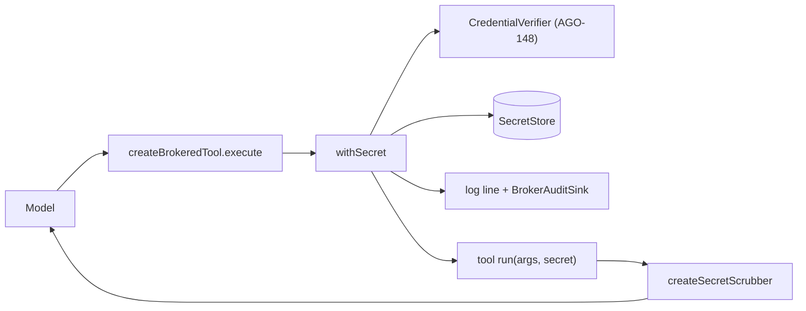

# Credentials: the credential broker
Tickets: AGO-157 (created). Related: AGO-148 (agent identity and short-lived credentials), AGO-104 (redaction), AGO-185 (secrets vault, planned)

## What it does
Secrets stay on the server. An agent, and the model behind it, never sees a key value. A tool names a secret by reference (`secret:crm_api_key`) and the worker-side broker uses the real value for the tool. Whatever the tool returns is cleaned of the value before it goes back.

## Screens
None. This is worker-internal. A later ticket (AGO-185) adds the secrets screen.

## Data model
No tables yet. Values live behind the `SecretStore` interface. `createInMemorySecretStore` is for tests and first wiring. The database vault (encryption at rest, UI) is AGO-185 and plugs in behind the same interface.

A `SecretEntry` is `{ workspaceId, name, value, capabilities[] }`. A secret can serve only the capabilities it is bound to.

## Data flow

Steps inside `withSecret`:
1. Check the input is `secret:<name>`. A pasted key is refused.
2. Verify the run's agent credential for the tool's capability.
3. Ask the store for the value (workspace and capability scoped). Any miss looks the same: `secret_unavailable`.
4. Write the audit entry **before** releasing the value. If it cannot be recorded, the call does not happen.
5. Run the tool's function with the value. Scrub the returned text and any error of the value (raw, base64, base64url, hex, URL-encoded, JSON-escaped) and then the shared credential patterns.

The policy engine still decides the call first. The broker never approves anything.

## Main functions and files
| function / component | file | role |
|---|---|---|
| `createCredentialBroker`, `withSecret` | `apps/worker/src/credentials/credential-broker.ts` | The broker: verify, resolve, audit, run, scrub |
| `createBrokeredTool` | `apps/worker/src/credentials/brokered-tool.ts` | Builds an `AgentTool` whose input is `secret_ref` plus its own args |
| `createSecretScrubber`, `secretForms` | `apps/worker/src/credentials/secret-scrubber.ts` | Removes a value and its encodings from text |
| `SecretStore`, `createInMemorySecretStore` | `apps/worker/src/credentials/secret-store.ts` | Where values come from |
| `secretRefSchema`, `secretNameOf`, `BrokerAuditEntry`, `BROKER_DENIAL_REASONS` | `packages/shared/src/credentials/broker-schemas.ts` | Reference format, audit shape, denial codes |

## Rules and edge cases
- Every call produces one log line and one `BrokerAuditSink` entry: workspace, run, agent, tool, capability, reference name, outcome (`allowed`, `denied`, `error`) and a stable reason. Never a value, a token or the tool's input. Denials are audited too (best effort; the refusal stands even if the sink is down).
- The log line carries the name as `broker_ref`, because the shared log masker hides `secret:<x>`. The sink gets the full reference.
- Errors the tool throws are scrubbed. A non-Error throw becomes the fixed message `tool failed`.
- `secret_ref` is a reserved input field. Extra input fields are rejected.
- Limit: a function that transforms the value (hashes it, then returns it) can defeat value matching. Review tools that handle secrets.
- Limit: a value split across two lines of output is not value-matched; the shared pattern scrubber still runs.
- The broker is not yet wired into the production tool registry. That comes with the first secret-using tool.

## How to extend it
- New secret-using tool: call `createBrokeredTool` with `capabilityKey`, `args`, `credentialFor` and a `run(args, secret)` that returns text.
```ts
const crmLookup = createBrokeredTool({
  name: "crm_lookup", description: "...", tier: 1, capabilityKey: "crm.read",
  args: { query: z.string() }, modelProperties: { query: { type: "string" } }, modelRequired: ["query"],
  broker, credentialFor: (ctx) => tokenForRun(ctx.runId),
  run: (args, secret) => callCrm(args.query, secret),
});
```
- New value source: implement `SecretStore` (return `null` for every miss).
- New encoding to scrub: add it to `secretForms`.
- Tests: `pnpm --filter @ago/worker exec vitest run src/credentials`. `broker.e2e.test.ts` runs the real tool loop and searches prompts, run events, logs and audit for the value.
