# Flat view: agent cards
Tickets: AGO-150 (created)

Code: `apps/web/src/features/office/cards/`, page `apps/web/src/app/app/office/page.tsx`, browser client `apps/web/src/lib/supabase/browser.ts`.

## What it does
The Office page (`/app/office`) shows one card per agent of the workspace with its live state: Idle, Working, Thinking, Collaborating, Waiting on you, or Error or paused. States come only from the office store (AGO-142), which folds `run_events`. "Waiting on you" is a red badge that opens the approval in the approvals inbox. Opening it never approves anything.

## Screens
- `/app/office`: grid of agent cards, a live-connection line (connecting, catching up, reconnecting, stopped), an empty state when the workspace has no agents, and a "Loading state…" placeholder until the first events arrive (a card never claims Idle before it knows).
- `/app/approvals?approval=<id>#approval-<id>-title`: the existing inbox, scrolled to that request. If the request is not pending any more (decided, expired, not visible), a "That request is no longer pending" note shows above the inbox.

## Color-independent states
Every state has its own text label and its own shape, so color is never the only signal (WCAG 1.4.1). Only "Waiting on you" uses the solid red (`destructive`) badge.
| State | Label | Shape |
|---|---|---|
| idle | Idle | dashed circle |
| working | Working | gear |
| thinking | Thinking | speech bubble |
| collaborating | Collaborating | two linked circles |
| waiting_on_you | Waiting on you | bell |
| error_or_paused | Error or paused | warning triangle |

## Data flow

```mermaid
flowchart LR
  Page[/app/office server page/] -->|agents, workspace id, public Supabase settings| Live[OfficeCardsLive]
  Live -->|user-scoped browser client, RLS| Source[createSupabaseOfficeSource]
  Source --> Store[office store]
  Store -->|selectOfficeAgentStates| Grid[AgentCardGrid]
  Grid --> Card[AgentCard + AgentStateBadge]
  Card -->|waiting_on_you| Link[/app/approvals?approval=id/]
```

## Main functions and files
| function / component | file | role |
|---|---|---|
| `AGENT_STATE_VIEWS` | `cards/agent-state-view.ts` | Label, description, shape and tone per state; exhaustive over the six states. |
| `AgentStateBadge` | `cards/AgentStateBadge.tsx` | Shape + label + tone. |
| `AgentCard` | `cards/AgentCard.tsx` | One agent; the badge is a link when waiting on you. |
| `AgentCardGrid` | `cards/AgentCardGrid.tsx` | Connects the store to a source and renders the cards and stream notices. |
| `OfficeCardsLive` | `cards/OfficeCardsLive.tsx` | Builds the Supabase source once from public settings. |
| `approvalHref`, `approvalLinkQuerySchema` | `cards/approval-link.ts` | The link and the page's query schema. |
| `ApprovalLinkNotice` | `cards/ApprovalLinkNotice.tsx` | The "no longer pending" note. |
| `createSupabaseBrowserClient` | `lib/supabase/browser.ts` | Shared browser client: takes the URL and anon key as arguments, reads no env. |

## Rules and edge cases
- Agent text (names, reason codes) is rendered as plain text, never as HTML or Markdown.
- The card only navigates. Deciding stays in the inbox, on the human-only decide route.
- The browser client uses only the public URL and anon key and acts as the signed-in user, so row-level security applies. It is shared infrastructure for later flat-view and 3D tickets.
- The cards never read `run_events` themselves.
- A missing or invalid `approval` query changes nothing; a failed inbox load shows no "no longer pending" note (it cannot know).

## How to extend it
- New state: change the AGO-124 contract first, then add its entry to `AGENT_STATE_VIEWS` (the table will not compile without it).
- Another surface (mobile flat view, AGO-172): reuse `AgentCardGrid` with a source, or `AgentCard` alone.
