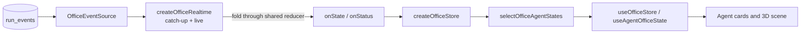

# Office store
Tickets: AGO-142 (created)

Code: `apps/web/src/features/office/store/`. Built on the office contract (AGO-124, `packages/shared/src/office/`) and realtime delivery (AGO-126, `apps/web/src/features/office/realtime/`).

## What it does
The office store is the one place the UI (agent cards, the 3D office floor) reads office state from. It never writes state itself: the state is a fold of `run_events` rows. After a page reload it rebuilds the same state from the stored events, then keeps up with live ones.

## Screens
No screen is added. Consumers (the agent cards and the 3D scene tickets) read the store through the hooks below. Nothing renders from it yet.

```tsx
useOfficeConnection(workspaceId, source); // once per workspace, `source` stable
const states = useOfficeStore(selectOfficeAgentStates); // six agent states, memoized
const card = useAgentOfficeState(agentId); // null: no run known, show idle
const status = useOfficeStore((s) => s.status);
```
Use selectors, not the whole store. Agent text in the state (errors, messages) is untrusted: render it as plain text.

## Data model
No tables or migrations. The store holds three fields:
| Field | Meaning |
|---|---|
| `workspaceId` | The workspace the store is scoped to; `null` before the first `connect`. |
| `office` | The AGO-124 `OfficeState` of that workspace; `null` before the first `connect`. |
| `status` | The AGO-126 stream status (`idle`, `connecting`, `live`, `catching_up`, `reconnecting`, `stopped`). |

Nothing is persisted. A snapshot of derived state is never trusted.

## Data flow

1. `connect({ source, workspaceId })` scopes the store to one workspace, starts it from an empty office and starts the AGO-126 controller.
2. The controller catches up from the stored events, then streams live rows. Each row goes through the shared reducer, which ignores duplicates, holds back rows that are ahead of their run and refills the gap by `seq`.
3. Every new state the controller produces is put in the store. That is the only write.

## Main functions and files
| function / component | file | role |
|---|---|---|
| `createOfficeStore` | `store/office-store.ts` | Builds the store. Handle has `getState`, `getInitialState`, `subscribe` only. |
| `connect` / `disconnect` | `store/office-store.ts` | The only actions. Open and close the event stream. |
| `selectOfficeAgentStates`, `selectOfficeAgentState` | `store/office-store.ts` | Six-state agent view, memoized per office object. |
| `officeStore` | `store/use-office-store.ts` | The app-wide singleton (one per browser tab). |
| `useOfficeStore`, `useAgentOfficeState` | `store/use-office-store.ts` | Selector hooks for components. |
| `useOfficeConnection` | `store/use-office-store.ts` | Connects while mounted, disconnects on unmount. |

## Rules and edge cases
- No setter. `createOfficeStore()` returns `getState`, `getInitialState`, `subscribe` only, and the only actions are `connect` and `disconnect`.
- One workspace at a time. Connecting to another workspace resets the office first and closes the old stream. Rows of another workspace are counted in `office.anomalies.foreign` and never applied.
- Connecting to the same workspace while connected is a no-op, even if `source` changed. `useOfficeConnection` avoids this because its cleanup calls `disconnect` first.
- Same-workspace reconnect re-folds. After `disconnect`, the last state stays readable. But the next `connect` to the same workspace resets `office` to empty and folds the whole backlog again (no snapshot or cursor reuse). Expect a brief empty office, for example with React StrictMode's mount, unmount, mount in dev.
- `getState()` returns the live state object. The fields are typed `readonly`, so typed code cannot assign. A cast (`as`) could still mutate the live object at runtime, with no subscriber notified. The reviewer accepted this: all supported APIs are read-only, and the `OfficeState` objects come from the shared reducer (not frozen). Never mutate what you read. If runtime enforcement is ever needed, freeze at the AGO-124 or AGO-126 layer.
- A reload re-reads the whole feed (bounded by the AGO-126 paging caps); `status` is `catching_up` meanwhile.

## How to extend it
- New derived view: add a selector next to `selectOfficeAgentStates` and memoize it on the office object (WeakMap) so the reference stays stable.
- New office data: change the AGO-124 reducer or state in `packages/shared/src/office/`, not the store. The store must stay a thin holder.
- Never add a setter or an action that writes `office` directly. Ask first before persisting any derived state.
