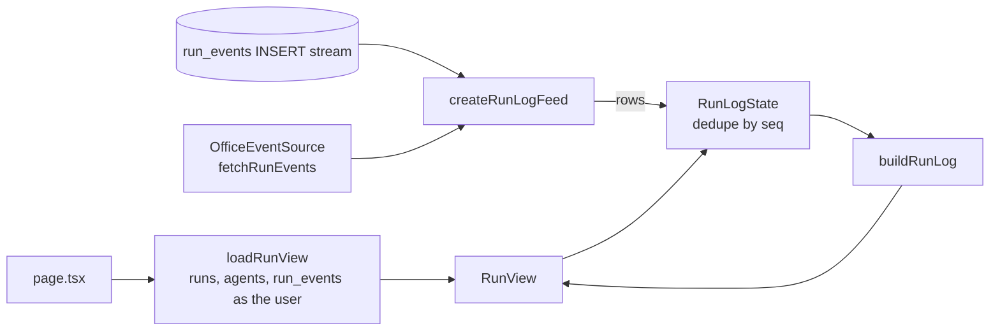

# Run view
Tickets: AGO-153 (created)

Code: `apps/web/src/features/runs/run-view/`, route `apps/web/src/app/app/runs/[runId]/page.tsx`. Built on the typed run events (AGO-164), the office event source port (AGO-126) and the budget events (AGO-40).

## What it does
`/app/runs/<run id>` shows one run: its live log, steps, tool calls, tokens, cost and duration. It only reads. Nothing on the page can change a run.

## Screens
- **Header:** state (Queued, Running, Paused, Completed, Failed, Stopped), live status (Live, Catching up, Reconnecting, Not live), agent, duration, steps, start time (UTC).
- **Usage:** input tokens, output tokens, cost, model calls.
- **Banners:** stopped by the budget (scope, plain reason, used of limit), failed (reason and message), paused, "some events have not arrived yet", unrecognised events.
- **Tool calls:** tool name, tier, status (including denied by policy and waiting for approval), duration, policy reason, error code and message.
- **Log:** every event in order with its time and a short label; agent messages and error text underneath.
- **Not found:** a missing run, a run of another workspace and a malformed id show the same page and no data.

## Data model
No tables or migrations. Sources, all read as the signed-in user under RLS:
| Shown | Stored source |
|---|---|
| Log, steps, tool calls, state, errors | `run_events` (append-only) |
| Tokens and cost | the sum of the run's `budget.usage` events. The worker writes one right after it settles each model call against the AGO-40 ledger, with the settled `cost_cents`, so the total equals what the ledger recorded for the run. Nothing is estimated in the browser. |
| Agent, start and finish time | `runs`, `agents` |

The ledger table `budgets_usage` is per agent per day and not readable by members, so it cannot give a per-run total; the events can, and members can read them. A call with no recorded cost is counted in the note under the totals, and the cost is shown as "not reported" when no call has one.

## Data flow

1. The server reads the run and its events (oldest first, paged, capped at 5,000 rows) and passes them to the client.
2. The client subscribes to the workspace stream, keeps this run's rows, and after each `SUBSCRIBED` reads the run's rows after the last contiguous `seq`.
3. Rows are stored by `seq`. The log shows only the contiguous rows (1, 2, 3 with no hole); a row ahead of a missing one waits and triggers a read that fills the hole. Replays change nothing, so there are no duplicates and no gaps.
4. A closed or failed channel, or a failed read, reconnects with a doubling delay (1 s up to 30 s) and catches up again.

## Main functions and files
| function / component | file | role |
|---|---|---|
| `loadRunView` | `run-view/load-run-view.ts` | Server read of the run, agent name and events. Not found, or a generic error. |
| `applyRunRows`, `buildRunLog` | `run-view/run-log.ts` | Pure fold: dedupe, contiguous prefix, steps, tool calls, usage, stop reasons. |
| `createRunLogFeed` | `run-view/run-log-feed.ts` | Live stream, catch-up, gap fill, reconnect. |
| `RunView` | `run-view/RunView.tsx` | The screen. |
| `ExpandableText` | `run-view/ExpandableText.tsx` | Plain-text rendering with a cut and an expand control. |
| `createRunLiveSource` | `run-view/live-source.ts` | The browser stream source (see limitations). |

## Rules and edge cases
- **Untrusted text.** Agent messages, error text and tool names are rendered as plain text nodes only: no HTML, no Markdown, no links. Text over 280 characters is cut with a "Show more" control.
- **Duration.** From the start event to the end event; ticks every second only while running; frozen at the pause time while paused; fixed once finished.
- **Hashes.** Tool call input and output hashes are not shown (they are not content).
- **Unknown events.** An event this version does not know, or whose payload does not match, is a visible "Unrecognised event" line and never an error.
- No service-role key; every query names the workspace.

## Known limitations
- **Tool inputs and results are not shown.** The events hold only hashes; the scrubbed text lives in `private.run_checkpoints`, which the web app cannot read. A follow-up must store it somewhere members can read (needs the schema slot).
- **Live updates need the browser Supabase client.** `createRunLiveSource` returns `null` until `apps/web/src/lib/supabase/browser.ts` (AGO-150) is on `main`; until then the page shows the log the server read, marked "Not live". Wiring is `createSupabaseOfficeSource(browserClient)`.
- A run with more than 5,000 events loads the rest in the browser through the catch-up read.

## How to extend it
- New event type: add its label in `describe()` in `run-log.ts`; until then it shows as a visible "Unrecognised event" line.
- Tool input/result text: add a field to `ToolCallView` from the new stored source and render it with `ExpandableText`.
