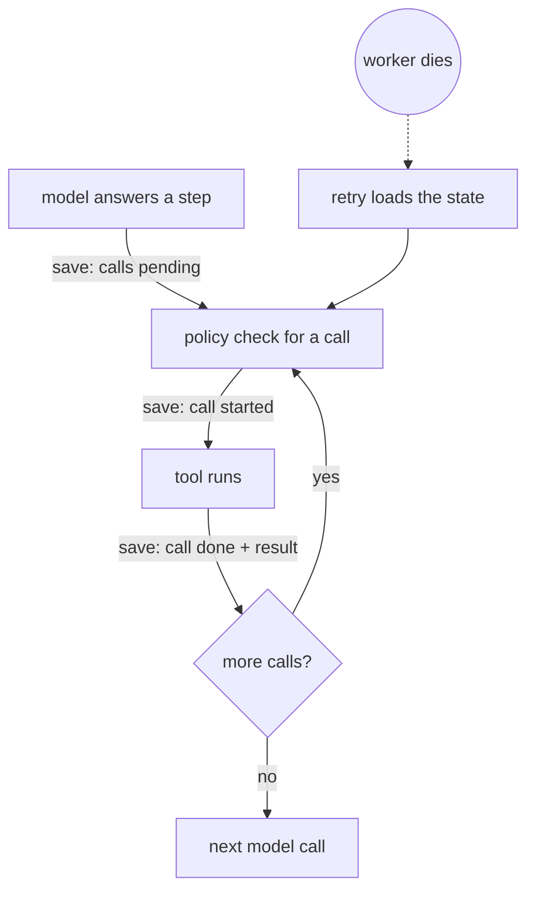

# Runs: checkpoint, pause and resume

How an agent run survives a worker crash and how a human pauses and resumes it (AGO-30, epic EP-02). The run
loop itself is AGO-167; limits are AGO-166. Code: `apps/worker/src/agent/`, `apps/worker/src/queue/`,
`packages/shared/src/runs/`.

## The short version
- The loop saves its state in `private.run_checkpoints` after the model answers a step, before each tool runs and
  after each tool finishes.
- If the worker dies, the queue retries the job and the loop **continues from the saved state**. Tool calls that
  finished are not run again, and the model is not asked again for a step it already answered.
- A human can ask a run to pause. It stops at the next safe point, **never in the middle of a model call**, so a
  paused run holds no open model call. A human resumes it; an agent never can.

## What is saved
One row per run (`private.run_checkpoints`, primary key `workspace_id` + `run_id`, deleted with the run):

| Column | Content |
|---|---|
| `state` | The loop state, validated by `runCheckpointStateSchema` (`packages/shared`): steps and tokens so far, the loop-detection counters, the tool results the model would still be shown, and the step in progress (each call: `pending`, `started`, `awaiting_approval` or `done`, with its stored result). Under 1 MB. |
| `pause_requested_at` | Set when a human asks for a pause; cleared by a resume. |

Tool inputs and results are stored already scrubbed (the same text the model sees). The table lives in the
`private` schema with no grant for `anon`, `authenticated` or `service_role`, so tool output is never readable
through the Data API; only the worker's own database role reads it. The checkpoint is deleted when the run ends
(succeeded, or failed for good). A run that is only paused keeps it.

## Crash recovery

On the retry, `execute()` loads the state and continues the open step:

- `done` call: skipped, its stored result is reused (no policy check, no tool run).
- `pending` call: goes through the normal policy path and runs once.
- `started` call (the worker died after it began and before its result was saved): **never run again**. It may
  have run, so the loop records it as failed with `outcome_unknown` and tells the model so; the model decides.
- `awaiting_approval` call: recorded as denied (`approval_not_granted`). Nothing resumes into running an
  unapproved call. AGO-21 adds the approval decision and the approved path.

Steps and tokens carry over, so a crash-and-resume loop cannot escape the step and token limits (AGO-166). Wall
time restarts with each attempt. A `run.recovered` event (`step`, `completed_calls`, counts only) marks a run
picked up from a saved state.

A saved state that does not parse (damaged, or a version this worker does not know) fails the run at once with
reason `checkpoint_unreadable`. Starting over would repeat tool calls, so the loop never guesses.

## Pause and resume
- `requestRunPause(ref, human)` records the request for a `queued` or `running` run. The loop checks it at the top
  of each step and right after the model answers, before any tool runs. It never aborts an in-flight model call.
  The loop saves its state, returns `paused` (reason `user_pause`), and the processor writes `run.paused`
  (`requested_by: human`). An approval pause (tier 3 and 4) is unchanged (`requested_by: policy`).
- `resumeRun(ref, human)` moves a `paused` run to `queued`, writes `run.resumed`, and enqueues a new job. Only the
  first of several resumes does anything. If the job cannot be enqueued, the run goes back to `paused`.
- Both take a human actor and refuse anything else (`HumanActorRequiredError`). They are worker services; the
  control UI that calls them is AGO-21 (no HTTP route in this ticket). The caller must have authenticated the human
  and checked their role in the workspace.

## Operating notes
- Rollback: `supabase/rollbacks/20261113040001_ago_30_run_checkpoints.down.sql` drops the table. Runs in flight
  then start over on a retry, as before this ticket.
- A run left `paused` is not retried by the queue; it waits for a human.
- Tests: `agent-loop.checkpoint.test.ts` (a crash at every save point, the pause rules, limits carried over),
  `run-control.test.ts`, `checkpoint.integration.test.ts` (real Postgres and queue; run in the db lock) and
  `supabase/tests/run_checkpoints.test.sql` (pgTAP).
