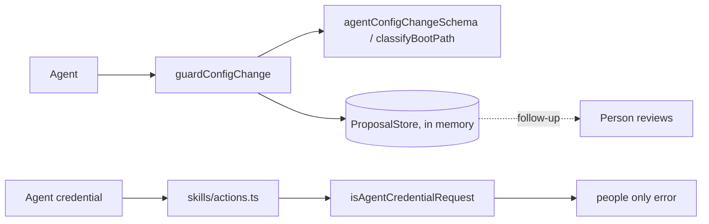

# Self-modification protection
Tickets: AGO-154 (created; US-029, epic EP-17)

## What it does
Only people change an agent's prompt, skills, policies and boot files. When an agent tries, its attempt becomes a pending **proposal** and nothing changes. A request that carries an agent credential is refused by the skill actions in the web app.

## Screens
No new screen. The skill actions (create, save, assign, unassign) return the error "Agents cannot change skills. This action is for people only." for an agent credential. The proposal review screen is a follow-up.

## Data model
None persisted yet. A `ConfigProposal` (`id`, `workspaceId`, `agentId`, `kind`, `targetRef`, `proposedContent`, `status: "pending"`, `createdAt`) is held by a `ProposalStore`. Protected kinds: `agent_prompt`, `skill`, `policy`, `boot_file` (`PROTECTED_TARGET_KINDS`).

## Data flow

## Main functions and files
| function / component | file | role |
|---|---|---|
| `guardConfigChange` | `apps/worker/src/self-modification/config-guard.ts` | Validates, stores a pending proposal, returns `proposed` or `denied`. No apply path, never throws, never returns content |
| `ProposalStore`, `createInMemoryProposalStore` | `apps/worker/src/self-modification/proposal-store.ts` | Create-only store interface and the in-memory implementation |
| `agentConfigChangeSchema`, `configProposalSchema`, `ConfigGuardResult` | `packages/shared/src/self-modification/self-modification-schemas.ts` | Shared shapes |
| `classifyBootPath` | same file | True when a path is a boot file |
| `isAgentCredentialRequest` | `apps/web/src/lib/auth/human-only.ts` | True when the request has an agent credential (`ago_agt_...`) |
| `rejectAgentCredential` | `apps/web/src/features/skills/actions.ts` | Runs first in the four skill actions |

## Rules and edge cases
- A boot file is any `_boot` or `.claude` segment, a file named `AGENTS.md`, `CLAUDE.md` or `BOOT.md`, or a path with `..`. Case and slash style do not matter.
- Malformed input and a store failure both return `denied` (fail closed). The proposed content is never returned or logged. There is no "human" actor in the guard.
- The agent check runs before validation, so an agent gets no field hints, even with a session cookie. The proxy rule from AGO-148 already refuses agent credentials on every route.
- Limits: content up to 100000 characters, target up to 500.
- Known limits: proposals are lost on restart; `classifyBootPath` does not decode or canonicalize paths (percent-encoding, NFKC, trailing dots, NTFS streams, 8.3 names, symlinks).

## How to extend it
- New protected kind: add it to `PROTECTED_TARGET_KINDS` in `self-modification-schemas.ts`.
- New boot file rule: edit `BOOT_DIRECTORY_SEGMENTS` or `BOOT_FILE_NAMES` there, and add a case to `boot-path.acceptance.test.ts`.
- Persist proposals: implement `ProposalStore` against a new proposals table (with RLS) in a follow-up ticket.
- New agent-side write path (vault write tool AGO-121, agent edit actions AGO-89): call `guardConfigChange`, and call `isAgentCredentialRequest()` first in any web action that changes protected config. AGO-121 must canonicalize paths before classifying.
