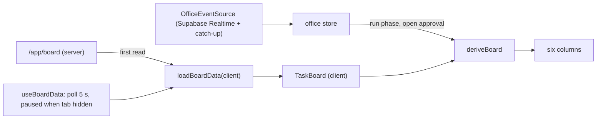

# Task board
Tickets: AGO-146 (created)

Code: `apps/web/src/features/work/board/`, route `apps/web/src/app/app/board/page.tsx`. Built on the office store (AGO-142, [office-store.md](office-store.md)), realtime delivery (AGO-126, [office-events.md](office-events.md)) and the approvals inbox (AGO-37, [approvals.md](approvals.md)).

## What it does
A read-only board of every task in the workspace, in six columns: **Inbox, Assigned, In progress, In review, Waiting on you, Done**. Cards move as agents work, with no reload. The board never approves, denies, edits or moves a task; a card blocked on an approval links to the approvals inbox, where a person decides.

## Screens
- `/app/board` (any member, owner or viewer): the six columns. Wide screens: a horizontally scrollable row. Narrow screens: columns stack.
- Each card: the task title, why it is in its column ("Running", "Paused", "Waiting for your approval", ...), the agent, and (when blocked on an approval) an **Open the approval** link.
- Visible states: *Loading* until the stream is up, an empty message per column, "No tasks yet" for an empty workspace, "Couldn't refresh the tasks. Showing the last list, retrying..." when a read fails, and the same stream notices as the agent cards ("Reconnecting...", "Catching up...").
- `/app` has a **Board** link next to Goals and Agents.

## Data model
None. No table, column, migration or RPC. The board reads `tasks`, `runs`, `approvals` and `agents` as the signed-in user (row-level security), always scoped by `workspace_id`, plus the office store.

## Data flow

Run state (what moves a card) comes **only from the office store**, so it follows the realtime stream and its catch-up after a reconnect (duplicates are ignored, gaps are refilled by `seq`: AGO-126). The polled read supplies what the stream does not carry: the task list, which run belongs to which task (`run_events` do not name the task in the store) and the pending approval rows (their age and id). It runs every 5 s, never two reads at once, backs off to 15 s after failures, pauses while the tab is hidden, and reads again when it becomes visible. A run the stream shows that no loaded row maps triggers one extra read (once per run id).

## Column mapping (task and run state to column)
First matching rule wins. "Live run" means a run in phase `queued`, `active` or `paused`.
| # | Column | Rule |
|---|---|---|
| 1 | Done | `tasks.status = 'done'` |
| 2 | Waiting on you (group 1) | a live run has an open approval request |
| 3 | Waiting on you (group 2) | a live run is `paused`, or the latest run `failed` and none is live |
| 4 | In progress | a live run is `active` |
| 5 | In review | the latest run `completed` and none is live, **or** `tasks.status = 'in_review'` |
| 6 | Assigned | `agent_id` is set, or a run is queued |
| 7 | Inbox | no agent, nothing running |

- **Waiting on you order:** tasks blocked on an approval first (oldest request first), then paused or failed ones (oldest first). That is the "blocked approvals first" rule.
- A run the stream has events for is judged by the stream alone: the moment `approval.decided` arrives the card leaves Waiting on you, even if the polled approval row is stale. A run the stream has no events for falls back to the polled `runs.status` (`queued`, `running`/`active`, `paused`, `failed`, `stopped`, `completed`/`succeeded`; anything else is ignored).
- A `stopped` run does not count as live: the task goes back to Assigned.
- Other columns: newest activity first. Done shows the newest 25 and says "and N older".

### In review is a stand-in (decision D1)
Nothing sets a review status on a task today. So **In review is derived**: the latest run completed and the task is not done, plus any task whose status is the free-text value `in_review`. When a real review status ticket lands, replace rule 5 in `derive-board.ts` (`deriveBoard`) and this table, and keep the tests in `derive-board.test.ts` ("puts a task whose latest run completed in In review"). Likewise nothing sets `tasks.status = 'done'` yet, so Done fills once the runtime or a person sets it.

## Main functions and files
| function / component | file | role |
|---|---|---|
| `deriveBoard`, `findUnmappedRunIds` | `board/derive-board.ts` | Pure: tasks, runs, approvals and office state in, six columns out |
| `loadBoardData`, `BoardLoadError` | `board/load-board-data.ts` | One read-only, workspace-scoped load over any Supabase client (server page and browser poll share it) |
| `useBoardData` | `board/use-board-data.ts` | Polling, visibility pause, backoff, refetch for unmapped runs |
| `TaskBoard`, `BoardTaskCard` | `board/TaskBoard.tsx` | The columns and cards; connects the office store |
| `TaskBoardLive` | `board/TaskBoardLive.tsx` | Builds the browser client and event source from the public settings |
| types and column labels | `board/board-types.ts` | Serializable board data |
| page | `app/app/board/page.tsx` | Thin route: first read as the signed-in user |

## Rules and edge cases
- **Untrusted text.** Task titles and agent names are rendered as React text only. A title like `` shows as text.
- **No write path.** No server action, no mutation call, no service-role key; a test scans the board sources for these. The client never imports the root `@ago/shared` barrel or the env module (a test and `scripts/check-client-bundle.mjs` guard it).
- **Caps.** 200 newest tasks (by update), 1,000 newest runs that belong to a task, 100 pending approvals. A task whose runs are older than that cap is placed by its task row alone.
- A failed first server read is not fatal: the board starts in its loading state and its own polling retries.
- Approvals are polled, not pushed (the table is not in the realtime publication; a migration would be another ticket). The stream still moves the card at once when `approval.requested` and `approval.decided` arrive.

## Tests
- `derive-board.test.ts`: every column rule, the Waiting on you order, stale approval rows, caps, one card per task.
- `TaskBoard.test.tsx`: through the real office store with a fake event source: a card moves with new run events (no reload), reconnect catch-up with no duplicate card and no gap, a gap refilled by `seq`, blocked-approval-first ordering, loading, empty, error, plain-text rendering, no approve or deny control.
- `use-board-data.test.tsx`: polling, hidden-tab pause, backoff and recovery, one read at a time, refetch once per unmapped run.
- `load-board-data.test.ts`: every query scoped by `workspace_id`, read-only, fixed error text, plus the client-bundle and no-write-path source scans.

## How to extend it
- New column or a real review status: change `BOARD_COLUMN_IDS` and `deriveBoard` together; update the table above.
- Task detail (AGO-155): link a card to it from `BoardTaskCard`; keep the board read-only.
- Push instead of poll for approvals: add `approvals` to the realtime publication (migration), then feed `useBoardData` from it.
