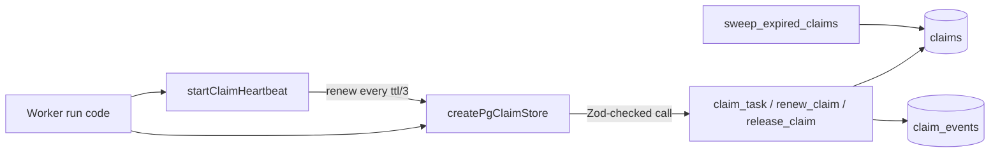
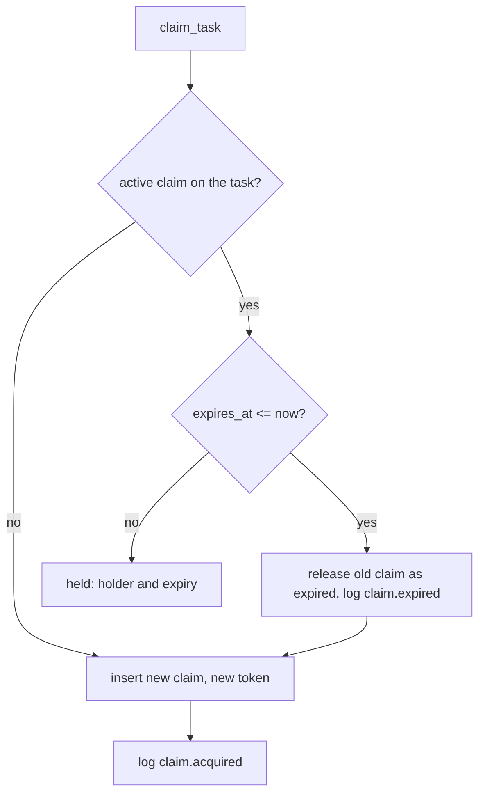

# Tasks: claims with expiry
Tickets: AGO-160 (claims with expiry created)

How one agent owns a task at a time, and how abandoned work frees up (AGO-160, epic EP-05). Code:
`apps/worker/src/claims/`, `packages/shared/src/claims/`, migration
`supabase/migrations/20261114010001_ago_160_task_claims.sql`.

## The short version
- An agent **claims** a task before working on it. The database decides, in one statement, so two workers that
  try at the same instant never both win.
- A claim **expires** if nobody renews it (default 5 minutes). Once it has expired, any other agent can take the
  task. Expiry is judged by the database clock (`now()`), never by a worker's clock.
- Every claim carries a **claim token** (the fence). Renew, release and complete need the current token, so the
  old holder of a taken-over task cannot touch the new claim.
- Every claim, renewal, release, completion and expiry is one row in the append-only `claim_events` table.
- A person is still in the loop: a claim only reserves a task. It does not approve anything, and claims are
  written by the worker (`service_role`) only. An agent never claims on behalf of another agent.

## Screens
None yet. Claims are a worker and database feature; the board will read `claims` for task ownership later.

## Data model
- `claims` (one row per claim): `task_id`, `agent_id`, `run_id?`, `claimed_at`, `expires_at` (not null),
  `renewed_at`, `released_at`, `release_reason` (`released`, `completed`, `expired_takeover`, `expired_sweep`), `claim_token` (the fence).
  A partial unique index `claims_one_active_per_task_idx` allows one row per task with `released_at is null`.
- `claim_events`: append-only history, one row per acquire, renew, release, complete or expiry.
- A claim belongs to a workspace, a task and an agent; all three must be in the same workspace.

## Data flow

## The four functions
All are `SECURITY DEFINER` with `search_path = ''`, fully qualified names, and `EXECUTE` for `service_role` only
(revoked from `PUBLIC`, `anon` and `authenticated`; a pgTAP test asserts exactly that).

| Function | What it does | Answers |
|---|---|---|
| `claim_task(workspace, task, agent, run?, ttl_seconds = 300)` | Releases an expired claim on the task (if any), then inserts a new claim with `ON CONFLICT ... DO NOTHING` on the partial unique index `claims_one_active_per_task_idx`. | `claimed` (with `claim_id`, `claim_token`, `expires_at`), `held` (with the holder and its expiry, never the token) or `refused` with a reason |
| `renew_claim(workspace, claim, token, ttl_seconds = 300)` | Moves `expires_at` forward for a live claim. | `renewed` or `refused` |
| `release_claim(workspace, claim, token, reason)` | Ends the claim as `released` (give it back) or `completed` (done). | `released`, `completed` or `refused` |
| `sweep_expired_claims(workspace?)` | Frees every expired claim (one workspace or all) and logs each. | the number freed |

`claim_task` refusal reasons: `invalid_ttl` (allowed 10 to 3600 seconds), `task_not_found`, `agent_not_found`,
`workspace_mismatch` (agent and task are not in the workspace given), `agent_archived`, `run_mismatch`.
Renew and release refusal reasons: `claim_not_found`, `stale_token`, `claim_released`, `claim_expired`,
`invalid_ttl`, `invalid_reason`. A refusal is always a specific reason, never a silent false.

"Active agent" means **not archived** (`agents.archived_at is null`): `agents.status` is free text with no
vocabulary, so it is not used. The agent row is read with `FOR SHARE`, so an archive cannot slip in between the
check and the insert. This closes AGO-89 follow-up 2 for the claim path.

## Expiry and takeover

- **Lazy expiry.** `claim_task` frees an expired claim itself, so a task never stays stuck waiting for a sweeper.
- **Sweep.** `sweep_expired_claims` frees expired claims nobody asked about, so a task shows as free in the
  board. Scheduling it (a pg-boss job) is a follow-up; the function and `ClaimStore.sweepExpired` exist.
- **Fence.** The token is rotated on every claim. After a takeover the old holder's renew, release and complete
  are refused (`stale_token` on the new claim, a released or expired reason on the old one). An expired claim that
  nobody has taken yet can still be ended by its holder; the event records `after_expiry`.
- **Token privacy.** `claims.claim_token` is excluded from the members' column-level `SELECT` grant, so it never
  reaches the Data API. It is never written to `claim_events`.

## The worker side
- `createPgClaimStore(pool)` (`claim-store.ts`) is the port: `claim`, `renew`, `release`, `sweepExpired`. Each is
  one SQL function call with parameterized values; inputs and results go through the Zod schemas in
  `@ago/shared` (`claimTaskInputSchema`, `claimTaskResultSchema`, ...). There is no check-then-act in code.
- `startClaimHeartbeat({ store, ref, ttlSeconds, onLost })` (`claim-heartbeat.ts`) renews every ttl / 3. When the
  database refuses a renew it calls `onLost("refused:<reason>")` once and stops. A transient database error is
  tolerated; if no renew succeeded for a whole ttl it calls `onLost("unreachable")`. The timer is a courtesy:
  the token fence is what keeps a late write out.

## The audit trail
`claim_events` (`workspace_id`, `task_id`, `claim_id`, `agent_id`, `type`, `payload`, `created_at`) has types
`claim.acquired`, `claim.renewed`, `claim.released`, `claim.completed`, `claim.expired`. It is append-only for
every role (revoke plus a trigger; the only removal is the cascade when the workspace itself is deleted). Members
and viewers read their own workspace's rows. Events carry no foreign keys on task, claim or agent, so the trail
outlives a deleted task.

## Tests
- `supabase/tests/task_claims.test.sql` (pgTAP): function privileges and `search_path`, the token column grant,
  one winner, every refusal reason, renew, expiry, takeover, the fence after a takeover (renew, release and
  complete), sweep, append-only events, RLS, workspace erasure.
- `apps/worker/src/claims/claims.integration.test.ts` (live local database, skips when it is down): 25 races of
  two separate connections released at the same instant, a 6-way race, a race for an expired claim, old-holder
  fencing, archived and cross-workspace refusals, sweep and events. Exactly one winner every time.
- `apps/worker/src/claims/claims.test.ts`: store mapping and validation, heartbeat timing and loss handling.

## Known limits
- Sweeping is not scheduled yet (follow-up). Lazy expiry covers correctness; the sweep only tidies.
- `tasks.status` is not changed by a claim (decision D6); the board reads claims for ownership.
- The run loop does not call the claim store yet; wiring it in is the run loop's ticket.

## How to extend it
- New refusal reason: add it in the SQL function, then to `CLAIM_REFUSAL_REASONS` (or `CLAIM_FENCE_REASONS`) in
  `packages/shared/src/claims/claim-schemas.ts`, then a pgTAP case in `task_claims.test.sql`.
- New event type: add it to the `claim_events` type check in a new migration and log it with `private.log_claim_event`.
- Wire claims into a run: call `ClaimStore.claim`, start `startClaimHeartbeat`, and finish with `release(..., "completed")`.
- Schedule the sweep: a pg-boss job that calls `ClaimStore.sweepExpired`.
