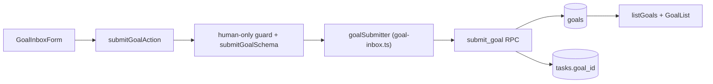

# Work: the goal inbox
Tickets: AGO-113 (goal inbox created)

## What it does
A workspace member types a goal ("grow signups by 20%") and submits it. The goal is saved, and the workspace's
Manager agent gets a task, "Plan goal: ...", that points at it. The Manager will later split the goal into tasks
(AGO-117). Empty goals are refused. Only people can submit; an agent credential is refused. Text only for now.

## Screens
- `/app/goals` (members and owners): a "New goal" box with a live counter (`n/5000`), a **Submit goal** button and
  the list of recent goals (newest first, latest 50, plain text). Errors appear under the box. With no Manager, the
  message links to `/app/agents/new`.
- `/app/goals` (viewers): the list only, with a note that only members can submit.
- `/app`: a **Goals** link next to Agents, Skills and Approvals.

## Data model
- `goals`: `id`, `workspace_id`, `text` (1 to 5000 characters, at least one visible character), `created_by`
  (member), `created_at`. RLS: any workspace member can read. No insert, update or delete grant for anyone.
- `tasks.goal_id` (nullable): the goal a task came from. Composite FK to `goals`, `on delete set null`. Set only by
  `submit_goal`.
- `submit_goal(p_workspace_id, p_text) returns uuid`: the only writer. `SECURITY DEFINER`, `search_path = ''`,
  execute for `authenticated` only.

## Data flow

## Main functions and files
| function / component | file | role |
|---|---|---|
| `submit_goal` | `supabase/migrations/20261120010001_ago_113_goals.sql` | Checks human session, membership and text; finds the Manager; writes goal and task together |
| `submitGoalAction` | `apps/web/src/features/work/actions.ts` | Server action: agent-credential refusal, Zod, submit, revalidate |
| `goalSubmitter`, `listGoals` | `apps/web/src/features/work/goal-inbox.ts` | Data layer: role check, RPC call, list, SQLSTATE to error code |
| `submitGoalWith` | `apps/web/src/features/work/submit-goal.ts` | Result or error to safe form state |
| `submitGoalSchema`, `normalizeGoalText`, `isGoalTextBlank`, `checkGoalText`, `countGoalCharacters` | `packages/shared/src/goals/` | Shared text rules; `./goal-limits` is the zod-free export for the browser |
| `GoalInboxForm`, `GoalList` | `apps/web/src/features/work/` | Form and list |
| goals page | `apps/web/src/app/app/goals/page.tsx` | Thin route; form for members, list for all |

## Rules and edge cases
- Text is normalised before saving: CRLF to LF, invisible characters (U+200B-200D, U+2060, U+FEFF, U+00AD,
  U+180E) removed, trimmed. Blank or over 5000 characters is refused. The same rule is in the form, the Zod schema,
  `submit_goal` and a CHECK; `goal-sql-parity.test.ts` keeps them in step.
- Error codes from `submit_goal`: `42501` not a human member (viewers, removed members, strangers, agent claims),
  `22023` empty or too long, `P0002` no Manager. Nothing is stored on any error.
- The Manager is the oldest active agent whose role is `Manager` (case-insensitive).
- Goal text is untrusted data: shown as plain text, never as markup; the task description does not contain it.
- Goals are immutable and are not deduplicated (two submits make two goals).
- Other format characters (for example U+200E, U+2800) count as text. The counter counts UTF-16 units; the database counts characters.

## How to extend it
- Attachments: add a storage-backed table linked to `goals`, and extend `submit_goal` or add a sibling RPC. Keep goals without direct insert.
- Edit or archive a goal: add a column or RPC; do not grant direct writes on `goals`.
- Change the text rule: edit `goal-limits.ts`, the CHECK and `submit_goal` together, then run `goal-sql-parity.test.ts`.
- Manager splitting (AGO-117) reads `goals` and the linked task through `tasks.goal_id`.
