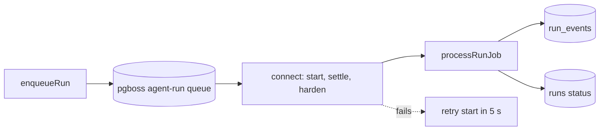

# Worker job queue

Tickets: AGO-213 (created: pg-boss start hardening, run failure order, gate lock rule)

How agent runs are queued and picked up by a worker, and how the queue locks down its own database functions.
Code: `apps/worker/src/queue/`, `scripts/workflow/checks.mjs`. The run checkpoint is in `runs.md`.

## What it does
- A run is put on a queue (a pg-boss job in the `pgboss` schema of the same Postgres database).
- A worker takes the job, runs the agent, and writes the run's events and status.
- A worker only consumes jobs after it has finished securing pg-boss. Until then it does not start the queue.
- A run that fails for good ends with a `run.failed` event first, then the failed status.

No screens. Operators see the start and retry messages in the worker log.

## Screens
None. Other features (runs, approvals) read the events and statuses this queue writes.

## Data model
- `pgboss` schema (owned by pg-boss): its queue, job and migration tables. The worker does not change their layout.
- The app queue is `agent-run`. Failed jobs go to `agent-run-dead`.
- The AGO-151 migration removes USAGE on the `pgboss` schema from the API roles (`anon`, `authenticated`, `service_role`).
- `run_events` is append-only. The `run.failed` event is one row there, written before the run's status changes.
- The run's status is on the run row. The checkpoint is in `private.run_checkpoints` (see `runs.md`).

## Data flow

The start path has three steps. First, pg-boss starts and creates its own tables and functions. Second, the settle loop revokes the default public execute permission on those functions, once pg-boss has finished its background setup. Third, the app queue and the consumer are created. Hardening uses its own small database pool, so it cannot starve the claim pool.

## Main functions and files
| Function / component | File | Role |
|---|---|---|
| `createJobQueue` | `apps/worker/src/queue/job-queue.ts:134` | Builds the queue: pools, start and retry, enqueue, stop. |
| `connect` | `apps/worker/src/queue/job-queue.ts:219` | One start attempt. Any throw fails the attempt. |
| `startWithRetry` | `apps/worker/src/queue/job-queue.ts:284` | Retries a failed start after 5 s, unless the queue is stopping. |
| `discardBoss` | `apps/worker/src/queue/job-queue.ts:212` | Stops a pg-boss instance that is not used, within a time bound. |
| `hardenPgbossFunctionsSettled` | `apps/worker/src/queue/pgboss-hardening.ts:175` | The settle loop: waits for pg-boss to settle, revokes, verifies. Throws after 60 s. |
| `isBamSettled` | `apps/worker/src/queue/pgboss-hardening.ts:136` | True when no background migration is pending or running. |
| `hardenPgbossFunctions` | `apps/worker/src/queue/pgboss-hardening.ts:212` | One revoke, retried up to 5 times, under the advisory lock. |
| `withPooledClient` | `apps/worker/src/queue/pgboss-hardening.ts:61` | Runs work on one pooled client within a time budget. |
| `createRunProcessor` | `apps/worker/src/queue/run-processor.ts:95` | Builds the job handler for one run. |
| `lockTakenByThisStep` | `scripts/workflow/checks.mjs:91` | Gate: true only when this step took the database lock. |

## Rules and edge cases
- **Fail closed.** If the settle loop cannot confirm the revoke within 60 s, the start fails. No consumer runs and enqueues are refused. The worker retries the start instead of running unhardened.
- **Settled first, then verified.** The loop accepts a pass only if pg-boss was settled before the revoke and no grants remain after it.
- **Bounded waits.** Each attempt has a 10 s budget. Statements inside the transaction have 5 s lock and statement timeouts. A stalled client is destroyed, not reused. A stalled pg-boss stop is abandoned after 5 s.
- **Hardening pool.** Two connections, keepAlive on, 10 s per query, and a 15 s idle-in-transaction timeout so an orphaned session cannot hold the lock for long. The timeout is set in the pool options and does not apply if the connection string overrides `options`.
- **Residual window.** A pg-boss function created after the loop finishes keeps its default public execute until the worker restarts. The schema has no USAGE for the API roles, so the function cannot be reached in that window.
- **Run failure order.** On the last attempt: `run.failed` is written, then the status becomes failed, then the checkpoint is dropped. If the event write fails, the run is still marked failed and the job failure still surfaces.
- **Duplicate jobs.** The `agent-run` queue is exclusive per singleton key, so a second enqueue of the same run is dropped while one is queued or active.
- **Gate lock.** The local gate's pgTAP step releases the database lock only if its own acquire took it. A lock that the caller already holds stays held.
- **Test budgets.** Live tests wait for conditions with budgets of 60 s to 180 s, to tolerate a loaded machine. Assertions do not change with them.

## How to extend it
- **A new check on pg-boss state:** add it to the `isSettled` callback passed from `connect`, so it is read before the revoke. Add a unit test in `pgboss-hardening.test.ts` with the fake pool.
- **A new queue or setting:** create it in `connect` after the hardening step. Do not create it before, or it runs unhardened.
- **A new run failure reason:** emit its event before the status write, as `handleFailure` does. Add a test in `run-processor.test.ts` that records the order.
- **A new gate step that takes a lock:** release it only when the step's own acquire took it, using the same rule as `pgtapStep`.
