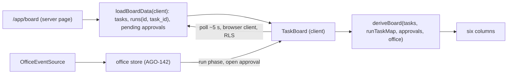

# AGO-146 - Build the task board (US-061)

Ticket: https://stratyge.atlassian.net/browse/AGO-146
PRs: https://github.com/CodeEx24/ai-agent-office/pull/93
Related: blocked by AGO-113 (goal inbox, merged) and AGO-142 (office store, merged) · unblocks AGO-155 (task detail) · links to AGO-37 (approvals inbox) · reads AGO-126 (realtime) and AGO-124 (office contract)
Type: Feature · Risk: Medium · Status: In progress (record awaiting acceptance)

## Overview
As a member, I want a board with Inbox, Assigned, In progress, In review, Waiting on you and Done so that I see work move.
The board is a read-only view at `/app/board`. Cards are tasks. A card's column comes from the task plus its runs'
live state. The board never approves, never writes, and never changes a task.

## Acceptance criteria (verbatim)
- Cards move with run state in realtime
- Waiting on you lists blocked approvals first
- Tests pass, no regressions, PR reviewed and merged, docs updated (see Definition of Done)

Testable readings (carried over in the brief): a test shows a new run state moving a card without reload; a test shows
a reconnect catches up with no duplicate card and no gap; a test shows tasks blocked on a pending approval sort first,
oldest first, each linking to the approval.

## Assumptions
1. (code) `tasks.status` is free text, default `todo`; nothing writes any other value yet. So the column is derived on read; no schema. (migration 20261105020003)
2. (code) `run_events` carry no task id. `runs.task_id` does. The office store knows runs by id only, so the board must map run id to task id from the `runs` table.
3. (code) `approvals` has `run_id`, `created_at`, `status`, `expires_at`, `consumed_at`. It is not in the realtime publication, so approvals are read by polling (as the approvals inbox does, AGO-37).
4. (code) RLS lets any member or viewer read `tasks`, `runs`, `approvals`, `run_events` of their workspace. No service role needed.
5. (guess) A task has at most a few runs; the board looks at the live ones and the latest ended one.

## Design
### Data flow

- `loadBoardData(client, workspaceId)` is one function over a Supabase client, so the server page (server client) and the
  browser poll (user-scoped browser client) share one code path. Reads are scoped by `workspace_id` under RLS. Task cap 200 (Done shows the newest 25).
- `deriveBoard` is a pure function: tasks + run-to-task map + pending approvals + `OfficeState` runs in, columns out. Unit tested on its own.
- Run states come only from the office store (`useOfficeConnection`, `useOfficeStore`). A run the store knows but the
  map does not (a run created after the page loaded) triggers one refetch of the map; until then it is ignored, not guessed.
- Agent and task text is rendered as plain text.

### Column mapping (task and run state to column)
Each task is placed by the first rule that matches (top to bottom):
| # | Column | Rule |
|---|---|---|
| 1 | Done | `tasks.status = 'done'` |
| 2 | Waiting on you | a live run of the task has an open approval (office `approval` channel, or a pending approval row), then a live run that is paused, or the latest run failed |
| 3 | In progress | a live run is `active` |
| 4 | In review | see decision D1 |
| 5 | Assigned | `agent_id` set (or a queued run), nothing running |
| 6 | Inbox | no agent, no live run |

"Live" = phase `queued`, `active` or `paused` (not terminal). Order in Waiting on you: tasks blocked on a pending
approval first, oldest approval first; then paused/failed items, oldest wait first. Other columns: newest activity first.
The card links to the approval (`approvalHref`, AGO-37 inbox) when blocked on one; the board has no approve or deny button.

### States
Loading (skeleton while the stream is `idle`/`connecting`), empty (per column and whole board), error (a failed read keeps
the last good board and says so, retries with backoff), reconnecting/stopped (same wording as the agent cards). Columns
are a horizontally scrollable row on wide screens and stack on a narrow one.

### Security
Workspace-scoped reads under the signed-in user's RLS; no service-role key in the web app; client components import only
subpaths (no root `@ago/shared` barrel). Untrusted text as React text. Read-only: no mutation, no server action. Agent tokens never reach this route (human session page).

## Decisions
| id | decision | options | choice | who / when |
|---|---|---|---|---|
| D1 | What is "In review"? | A: latest run completed and task not `done`, or `tasks.status = 'in_review'`. B: only `tasks.status = 'in_review'` (nothing sets it today, so the column stays empty). | recommended A (pending owner) | worker / 2026-11-20 |
| D2 | Freshness of non-event data (new tasks, approvals) | poll the same loader every 5 s with the browser client (no migration) vs. add tables to the realtime publication (migration, not my slot) | poll | worker / 2026-11-20 |
| D1a | Owner answer (2026-11-20, via orchestrator): record accepted; D1 = A. The In review derivation is temporary and documented here and in the feature guide so a later review-status ticket can replace it. | | accepted | owner / 2026-11-20 |
| D2a | Owner answer: polling is for non-event data only (new tasks, approvals); run state MUST move cards from the realtime stream. Pause polling while the tab is hidden. | | accepted | owner / 2026-11-20 |
| D3 | Schema | none; derive on read | no migration | brief |

## Boundaries
- Always: scope by workspace_id under RLS; render untrusted text as text; keep the board read-only.
- Ask first: any migration, any new RPC, any change to `packages/shared/src/office/**`.
- Never: approve from the board; write `run_events`; use a service-role key.

## Tests planned
Pure `deriveBoard` table tests for every rule and the sort order; a fake `OfficeEventSource` test where a new run event moves a card with no reload; a reconnect test (drop, then catch-up: no duplicate card, no gap); component tests for loading, empty, error, reconnecting, link to the approval and no approve button; a client-import guard test; a live local-stack check under the db lock via the device tester.

## Known limitations (planned)
- Nothing sets `tasks.status = 'done'` yet, so Done fills only once the runtime or a human sets it; the board reads it.
- Approvals are polled (5 s), not pushed.
- No drag and drop, no editing.

## Round 2 changes (review round 1)
- UI: the "Open the approval" link is named after its task (`aria-label`), has a 44px tap target (`min-h-11`) and a focus ring.
- UX: a banner above the board ("N tasks are waiting on you. Jump to Waiting on you") shows only when something waits, so a blocked approval is visible at 1280px without scrolling. Column order stays as specified.
- Cheap items: the columns region is focusable with a label (keyboard scroll); the column count reads "N tasks" to screen readers.

## Follow-ups
- A next step or link on paused and failed cards in Waiting on you (needs the task detail page, AGO-155).
- Link the empty-board copy to the goal inbox.
- Split the long intro sentence.

## Outcome
(filled at merge)
